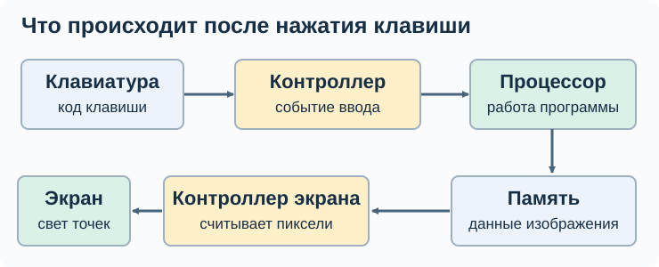

# Справочник по C++ и алгоритмам

Для 9–11 классов. Если ты только начинаешь писать на C++, открой [«Что такое переменная»](cpp/variables-and-memory.md). Если решаешь задачу, выбери ниже раздел по тому, что нужно сделать.

[Попробовать интерактивные примеры](https://yaroslav-yarik.github.io/cpm-robotics-programming/).

## Устройство компьютера

Представь, что программа выводит на экран нажатую клавишу. На рисунке стрелки показывают путь информации. Между нажатием и появлением буквы успевают поработать несколько устройств и операционная система.

| Вопрос | Где посмотреть |
|---|---|
| Как электрические сигналы складываются в число? | [Логические элементы, перенос и регистр](hardware/logic.md) |
| Что выполняется, когда в C++ написано `value = value + 5`? | [Три инструкции процессора](hardware/cpu.md) |
| Почему два соседних числа часто читаются быстрее? | [Кэш, оперативная память и адреса](hardware/memory.md) |
| Как напряжение датчика становится числом в программе? | [Ввод и вывод](hardware/io.md) |

## Язык C++

| Тема | Что можно разобрать на примере |
|---|---|
| [Что такое переменная](cpp/variables-and-memory.md) | Как запомнить число, изменить его и сохранить копию |
| [Как устроена память](cpp/memory-layout.md) | Где лежат элементы массива и что меняет запись через указатель |
| [Функции, ссылки и указатели](cpp/functions-and-pointers.md) | Как передать значение в функцию и изменить переменную вызывающего кода |
| [Массивы, векторы и итераторы](cpp/arrays-and-vectors.md) | Как хранить последовательность и обходить её элементы |
| [Строки](cpp/strings.md) | Как прочитать строку с пробелами, найти и выделить подстроку |
| [Стандартные алгоритмы и лямбды](cpp/stl-and-lambdas.md) | Как искать и считать элементы по своему условию |
| [Редактирование последовательностей](cpp/sequence-operations.md) | Как вставлять элементы, удалять повторы и преобразовывать значения |
| [Биты, маски и `std::bitset`](cpp/bits-and-bitset.md) | Как проверить один бит числа и хранить набор признаков |

## Базовые алгоритмы

В каждой теме есть код на C++ и Python. Индексы начинаются с нуля. В записи `[l, r)` левая граница входит в диапазон, правая остаётся за ним. Например, `[1, 4)` охватывает индексы 1, 2 и 3.

| Тема | Когда пригодится |
|---|---|
| [Сложность и перебор](algorithms/complexity-and-brute-force.md) | Нужно оценить, сколько вариантов успеет проверить программа |
| [Сортировка и ключи](algorithms/sorting.md) | Есть несколько правил упорядочивания записей |
| [Двоичный поиск](algorithms/binary-search.md) | Нужно найти границу в отсортированных данных или минимальный подходящий ответ |
| [Префиксные суммы](algorithms/prefix-sums.md) | Один массив или таблица, много запросов суммы |
| [Два указателя и скользящее окно](algorithms/two-pointers-and-window.md) | Ищем пару с заданной суммой или самый длинный допустимый отрезок |
| [Частоты](algorithms/frequencies.md) | Нужно посчитать вхождения значений или пары равных элементов |
| [Обходы клеточной карты](algorithms/grid-traversal.md) | Ищем достижимые клетки или кратчайший путь по клеткам |
| [Рекурсия и динамическое программирование](algorithms/recursion-and-dp.md) | Перебираем подмножества или собираем ответ из меньших подзадач |

## Прикладные алгоритмы

| Тема | Когда пригодится |
|---|---|
| [Состояние и события](robotics/state-and-events.md) | Нужно запомнить режим и обработать смену состояния |
| [Обработка сигналов](robotics/signals.md) | В последовательности измерений ищем устойчивый сигнал или серию |
| [Клеточные карты и изображения](robotics/grids-and-images.md) | Работаем с координатами, поворотами и препятствиями |

Примеры по языку используют C++17. Возможности C++20 отмечены отдельно.

## Программирование для практического тура

## Программирование для ЕТЗ
