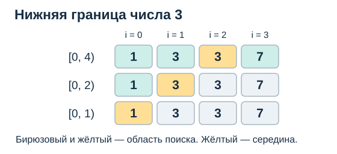

# Двоичный поиск

[Читать на сайте с интерактивами](https://yaroslav-yarik.github.io/cpm-robotics-programming/algorithms/binary-search.html).

[Оглавление](../README.md) · Базовые алгоритмы

## Как найти первую тройку

В массиве `[1, 3, 3, 7]` число 3 встречается дважды. Если нужно узнать, сколько здесь троек, удобно найти две позиции.

| Граница | Что ищем | Индекс |
|---|---|---|
| Нижняя | Первый элемент, который **больше или равен** 3 | 1 |
| Верхняя | Первый элемент, который **строго больше** 3 | 3 |

Тройки занимают индексы от 1 включительно до 3 исключительно. Их количество равно `3 − 1 = 2`. Для числа 4 обе границы равны 3, поэтому четвёрок в массиве нет. Если подходящего элемента нет, граница равна длине массива `n`. В пустом массиве она равна нулю.

### Почему можно отбросить половину

Массив отсортирован по неубыванию. Одинаковые значения могут стоять рядом. Посмотрим на поиск нижней границы тройки. Все элементы с индексом меньше `left` строго меньше цели. Все элементы с индексом `right` и больше подходят. Если `right` равен длине массива, справа пока нет элементов. Осталось проверить участок `[left, right)`.

| Проверяемый участок | Середина | Решение |
|---|---|---|
| `[0, 4)` | `values[2] = 3` | Тройка подходит. Ищем, есть ли подходящий элемент левее, `right = 2` |
| `[0, 2)` | `values[1] = 3` | Так же передвигаем `right` на 1 |
| `[0, 1)` | `values[0] = 1` | Единица мала. Переходим к `left = 1` |



<!-- interactive -->

Индекс середины позволяет сразу вычислить адрес элемента в непрерывном массиве C++. Для объекта размером 8 байтов элемент с индексом 2 начинается на 16 байтов дальше первого. В большом массиве последовательные проверки могут попасть в разные [строки кэша](../hardware/memory.md), поэтому длительность одного шага бывает разной.

Теперь `left == right == 1`. Это индекс первой тройки. Для верхней границы тройку считаем слишком маленькой и продолжаем поиск справа от неё.

В C++ функция ниже с параметром `find_upper = true` ищет верхнюю границу. В Python показаны две отдельные функции. Обе границы находятся за `O(log n)` времени с `O(1)` дополнительной памяти.

**C++**

```cpp
#include <cstddef>
#include <vector>

using std::size_t;
using std::vector;

using Int = long long;
using Numbers = vector<Int>;

size_t first_boundary(const Numbers& values, Int target, bool find_upper = false) {
    size_t left = 0, right = values.size();
    while (left < right) {
        size_t middle = left + (right - left) / 2;
        if (values[middle] < target || (find_upper && values[middle] == target)) {
            left = middle + 1;
        } else {
            right = middle;
        }
    }
    return left;
}
```

<details>
<summary>Тот же алгоритм на Python</summary>

```python
def lower_bound(values, target):
    left, right = 0, len(values)
    while left < right:
        middle = left + (right - left) // 2
        if values[middle] < target:
            left = middle + 1
        else:
            right = middle
    return left


def upper_bound(values, target):
    left, right = 0, len(values)
    while left < right:
        middle = left + (right - left) // 2
        if values[middle] <= target:
            left = middle + 1
        else:
            right = middle
    return left
```

</details>

В стандартных библиотеках уже есть обе операции. В Python это `bisect_left` и `bisect_right` из модуля `bisect`. В C++ функции `std::lower_bound` и `std::upper_bound` возвращают итераторы. Чтобы получить индекс в векторе, вычти `values.begin()` из итератора. Для проверки наличия числа сначала убедись, что индекс меньше `values.size()`, и только затем сравни элемент с искомым числом.

## Как найти минимальную вместимость

Нужно перевезти 11 одинаковых деталей не более чем за 3 рейса. Машина вместимостью 3 детали сделает четыре рейса. Машине вместимостью 4 хватит трёх. Ответ равен 4.

Двоичным поиском можно найти эту границу даже без готового массива. Если вместимости хватает, любая большая вместимость тоже подойдёт. Такое свойство называется **монотонностью**. Для проверяемой вместимости `middle` делим число деталей на неё нацело. Если остаток ненулевой, нужен ещё один рейс.

Число деталей `item_count` и лимит рейсов `batch_limit` должны быть положительными. Функция ищет вместимость от 1 до `item_count`. Верхняя граница заведомо подходит, потому что с такой вместимостью достаточно одного рейса. На каждом шаге мы уменьшаем диапазон примерно вдвое. При `n = item_count` время составляет `O(log n)`, дополнительная память — `O(1)`.

**C++**

```cpp
using Int = long long;

Int min_batch_size(Int item_count, Int batch_limit) {
    Int left = 1, right = item_count;
    while (left < right) {
        Int middle = left + (right - left) / 2;
        Int batches_needed = item_count / middle + (item_count % middle != 0);
        if (batches_needed <= batch_limit) right = middle;
        else left = middle + 1;
    }
    return left;
}
```

<details>
<summary>Тот же алгоритм на Python</summary>

```python
def min_batch_size(item_count, batch_limit):
    left, right = 1, item_count
    while left < right:
        middle = left + (right - left) // 2
        batches_needed = item_count // middle + (item_count % middle != 0)
        if batches_needed <= batch_limit:
            right = middle
        else:
            left = middle + 1
    return left
```

</details>

---

[← Сортировка и ключи](sorting.md) · [→ Префиксные суммы](prefix-sums.md)
