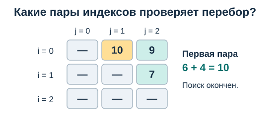

# Сложность и перебор

[Оглавление](../README.md) · Базовые алгоритмы

## Как посчитать объём работы

Пусть в списке `n` чисел. Чтобы найти максимум, нужно посмотреть на каждое число. Если увеличить список вдвое, сравнений тоже станет примерно вдвое больше. Такое время называют **линейным** и записывают `O(n)`. Для хранения текущего максимума достаточно одной переменной при любой длине списка, поэтому дополнительная память составляет `O(1)`.

Обозначение `O` даёт верхнюю оценку роста затрат при увеличении входных данных. В таблице указаны обычные оценки для операций с машинными числами.

| Время | Пример | Как растёт работа |
|---|---|---|
| `O(1)` | Обращение к элементу массива по индексу | Число действий постоянно |
| `O(log n)` | Двоичный поиск | При удвоении размера добавляется примерно один шаг |
| `O(n)` | Поиск максимума | При удвоении размера работы примерно вдвое больше |
| `O(n log n)` | Сортировка сравнением, например сортировка слиянием | При удвоении размера работы чуть больше чем вдвое |
| `O(n²)` | Перебор всех пар | При удвоении размера работы примерно вчетверо больше |
| `O(2ⁿ)` | Перебор подмножеств | Уже **один новый элемент** удваивает число вариантов |

## Как перебрать пары без повторов

Найдём два разных индекса, по которым стоят числа с суммой 10. В массиве `[6, 4, 3]` подходят индексы 0 и 1. Для массива `[5]` ответ отрицательный. Чтобы получить 10, пришлось бы взять одну и ту же пятёрку дважды.

1. Выбираем индекс `i` первого числа.
2. Второй индекс `j` перебираем от `i + 1` до последнего элемента. Так каждая пара встретится ровно один раз.
3. Как только сумма совпала, возвращаем положительный ответ. Отрицательный ответ можно дать лишь после окончания обоих циклов.



В каждой отмеченной клетке алгоритм читает два числа, складывает их и сравнивает сумму с целью. Процессор может оставить первое число в регистре на весь внутренний цикл. Число проверок пар мы можем вывести точно, а число машинных инструкций зависит от компилятора.

Для первого индекса есть `n − 1` возможных партнёров, для второго — `n − 2`, для последнего — ни одного. Всего это `n(n − 1)/2` пар. Поэтому время в худшем случае составляет `O(n²)`, дополнительная память — `O(1)`. При небольших входных данных такой перебор удобно использовать для проверки более быстрого решения.

В примерах справочника нумерация начинается с нуля. Запись `[l, r)` включает индекс `l` и исключает `r`. Для сумм в C++ используем `long long`. При решении задачи проверь по ограничениям, помещаются ли в этот тип промежуточные результаты.

**C++17**

```cpp
#include <cstddef>
#include <vector>

using Int = long long;
using Numbers = std::vector<Int>;

bool pair_brute(const Numbers& a, Int target) {
    for (std::size_t i = 0; i < a.size(); ++i) {
        for (std::size_t j = i + 1; j < a.size(); ++j) {
            if (a[i] + a[j] == target) return true;
        }
    }
    return false;
}
```

<details>
<summary>Тот же алгоритм на Python</summary>

```python
def pair_brute(a, target):
    for i in range(len(a)):
        for j in range(i + 1, len(a)):
            if a[i] + a[j] == target:
                return True
    return False
```

</details>

---

[→ Сортировка и ключи](sorting.md)
