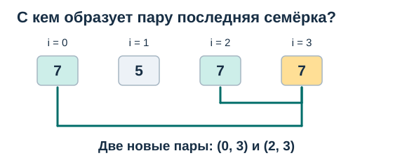

# Частоты

[Читать на сайте с интерактивами](https://yaroslav-yarik.github.io/cpm-robotics-programming/algorithms/frequencies.html).

[Оглавление](../README.md) · Базовые алгоритмы

## Сколько раз встретилось значение

**Частота** — это число появлений конкретного значения. В последовательности `[7, 5, 7, 7]` частота семёрки равна 3, частота пятёрки равна 1. Такие количества можно накапливать за один проход. Хранить их удобно по самому значению.

| Какие значения бывают | Где хранить частоты |
|---|---|
| Небольшие целые от 0 до `m − 1` | В массиве из `m` счётчиков. Для числа `x` увеличиваем `count[x]` |
| Произвольные целые, в том числе отрицательные | В словаре. Число служит ключом, частота — значением |

## Сколько есть пар одинаковых чисел

При встрече новой семёрки можно составить по одной паре с каждой предыдущей семёркой. Хватит числа таких семёрок, хранить их индексы не требуется.

| Очередное число | Сколько таких было раньше | Всего пар после шага |
|---|---:|---:|
| 7 | 0 | 0 |
| 5 | 0 | 0 |
| 7 | 1 | 1 |
| 7 | 2 | 3 |



<!-- interactive -->

Для подсчёта пар сначала прибавляем `frequencies[value]` к ответу, а затем увеличиваем счётчик. Поменяв эти действия местами, мы засчитали бы пару элемента с самим собой.

Если частоты лежат в массиве, индекс сразу задаёт смещение нужного счётчика в памяти. Для хеш-таблицы сначала вычисляют хеш ключа, затем ищут запись в выбранной группе. Если несколько ключей попали в одну группу, их приходится различать сравнением.

В Python используем `Counter`, в C++ — `std::unordered_map`. Обращение к счётчику в хеш-таблице в среднем занимает `O(1)`. Для `n` чисел время в среднем составляет `O(n)`, память — `O(u)`, где `u` — количество различных чисел. Если нужен порядок по ключам, в C++ подойдёт `std::map`. Для него весь проход занимает `O(n log(u + 1))`.

**C++**

```cpp
#include <unordered_map>
#include <vector>

using std::unordered_map;
using std::vector;

using Int = long long;
using Numbers = vector<Int>;

Int equal_pairs(const Numbers& values) {
    unordered_map<Int, Int> frequencies;
    Int pair_count = 0;
    for (Int value : values) {
        pair_count += frequencies[value];
        ++frequencies[value];
    }
    return pair_count;
}
```

<details>
<summary>Тот же алгоритм на Python</summary>

```python
from collections import Counter


def equal_pairs(values):
    frequencies = Counter()
    pair_count = 0
    for value in values:
        pair_count += frequencies[value]
        frequencies[value] += 1
    return pair_count
```

</details>

---

[← Два указателя и скользящее окно](two-pointers-and-window.md) · [→ Обходы клеточной карты](grid-traversal.md)
