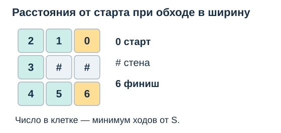

# Обходы клеточной карты

[Читать на сайте с интерактивами](https://yaroslav-yarik.github.io/cpm-robotics-programming/algorithms/grid-traversal.html).

[Оглавление](../README.md) · Базовые алгоритмы

## Как устроена карта

На карте `S` — старт, `F` — финиш, точка — свободная клетка, решётка — стена. Старт и финиш тоже проходимы. За один ход можно перейти вверх, вниз, влево или вправо. Диагональные переходы запрещены.

```text
..S
.##
..F
```

С этой картой можно задать два разных вопроса. Сколько ходов займёт кратчайший путь от `S` до `F`? И сколько всего клеток достижимо из `S`? В обоих решениях сначала пригодится одна и та же функция поиска соседей.

### Как найти соседей клетки

К номеру строки и столбца прибавляем по очереди четыре пары смещений. Для каждой новой позиции сначала проверяем границы, затем смотрим, свободна ли клетка. Так мы не обратимся за пределы карты. Функции обхода ниже предполагают, что старт и финиш заданы координатами существующих свободных клеток.

**C++17**

```cpp
#include <string>
#include <utility>
#include <vector>

using Grid = std::vector<std::string>;
using Cell = std::pair<int, int>;

std::vector<Cell> grid_neighbors(const Grid& grid, Cell cell) {
    std::vector<Cell> neighbors;
    const Cell shifts[] = {{-1, 0}, {1, 0}, {0, -1}, {0, 1}};
    for (auto [dr, dc] : shifts) {
        auto [row, col] = cell;
        int r = row + dr, c = col + dc;
        if (r >= 0 && r < static_cast<int>(grid.size()) &&
            c >= 0 && c < static_cast<int>(grid[r].size()) && grid[r][c] != '#') {
            neighbors.emplace_back(r, c);
        }
    }
    return neighbors;
}
```

<details>
<summary>Тот же алгоритм на Python</summary>

```python
def grid_neighbors(grid, row, col):
    for dr, dc in ((-1, 0), (1, 0), (0, -1), (0, 1)):
        r, c = row + dr, col + dc
        if 0 <= r < len(grid) and 0 <= c < len(grid[r]) and grid[r][c] != "#":
            yield r, c
```

</details>

## Поиск в ширину. Сколько ходов до финиша

Представь, что мы подписываем клетки слоями. На старте пишем 0, на всех его свободных соседях — 1, на их ещё не подписанных соседях — 2. Первое число, которое получит клетка, равно длине кратчайшего пути до неё. До следующего слоя мы уже проверили все пути на один ход короче.

```text
2 1 0    ← старт
3 # #
4 5 6    ← финиш
```



<!-- interactive -->

Очередь хранится в памяти. Когда клетка извлечена, её координаты нужны процессору для вычисления адресов соседей в таблице расстояний. Клетки одной строки таблицы C++ лежат подряд. У `vector<vector<int>>` каждая строка владеет своим участком памяти, поэтому переход на другую строку требует найти и её начало.

В коде порядок слоёв поддерживает **очередь**. Клетки добавляются в конец, а обрабатываются с начала. При первом добавлении соседа сразу записываем расстояние до него. Тогда даже клетка, к которой ведут два пути одинаковой длины, попадёт в очередь лишь раз.

Функция `grid_bfs` использует `grid_neighbors` из блока выше. Когда очередь дойдёт до финиша, функция вернёт его расстояние, на этой карте — 6. Если очередь опустела раньше, пути нет и функция вернёт `−1`. Для восстановления самого маршрута при добавлении клетки можно запомнить, из какой клетки мы пришли.

В Python очередь реализована с помощью `deque`. Удаление первого элемента обычного списка через `pop(0)` потребовало бы каждый раз сдвигать остальные элементы.

**C++17**

```cpp
#include <queue>

int grid_bfs(const Grid& grid, Cell start, Cell goal) {
    std::vector<std::vector<int>> distance;
    for (const auto& row : grid) distance.emplace_back(row.size(), -1);
    std::queue<Cell> queue;
    queue.push(start);
    distance[start.first][start.second] = 0;
    while (!queue.empty()) {
        auto cell = queue.front();
        queue.pop();
        int steps = distance[cell.first][cell.second];
        if (cell == goal) return steps;
        for (auto [row, col] : grid_neighbors(grid, cell)) {
            if (distance[row][col] == -1) {
                distance[row][col] = steps + 1;
                queue.emplace(row, col);
            }
        }
    }
    return -1;
}
```

<details>
<summary>Тот же алгоритм на Python</summary>

```python
from collections import deque


def grid_bfs(grid, start, goal):
    queue = deque([start])
    distance = {start: 0}
    while queue:
        cell = queue.popleft()
        if cell == goal:
            return distance[cell]
        row, col = cell
        for next_cell in grid_neighbors(grid, row, col):
            if next_cell not in distance:
                distance[next_cell] = distance[cell] + 1
                queue.append(next_cell)
    return -1
```

</details>

## Поиск в глубину. Сколько клеток достижимо

Теперь нужен только размер достижимой области. Можно идти в любую ещё не посещённую клетку, поэтому вместо очереди подойдёт **стек**. Из стека первой извлекают клетку, добавленную последней. Это обход в глубину. Явный стек позволяет обойти длинный коридор без цепочки рекурсивных вызовов.

Функция `grid_dfs_size` тоже использует `grid_neighbors`. При добавлении клетки помечаем её как посещённую. Когда стек опустеет, каждая достижимая клетка будет учтена ровно один раз. В примере таких клеток семь, включая старт и финиш. При нескольких маршрутах порядок первого посещения в этом обходе может дать длинный путь.

Оба обхода проверяют не более четырёх соседей каждой обработанной клетки. Для прямоугольной карты высоты `h` и ширины `w` время и память составляют `O(hw)`. Для словарей и множеств Python здесь учтена средняя стоимость обращения.

**C++17**

```cpp
int grid_dfs_size(const Grid& grid, Cell start) {
    std::vector<std::vector<bool>> seen;
    for (const auto& row : grid) seen.emplace_back(row.size(), false);
    std::vector<Cell> stack{start};
    seen[start.first][start.second] = true;
    int count = 0;
    while (!stack.empty()) {
        auto cell = stack.back();
        stack.pop_back();
        ++count;
        for (auto [row, col] : grid_neighbors(grid, cell)) {
            if (!seen[row][col]) {
                seen[row][col] = true;
                stack.emplace_back(row, col);
            }
        }
    }
    return count;
}
```

<details>
<summary>Тот же алгоритм на Python</summary>

```python
def grid_dfs_size(grid, start):
    stack = [start]
    seen = {start}
    while stack:
        row, col = stack.pop()
        for next_cell in grid_neighbors(grid, row, col):
            if next_cell not in seen:
                seen.add(next_cell)
                stack.append(next_cell)
    return len(seen)
```

</details>

---

[← Частоты](frequencies.md) · [→ Рекурсия и динамическое программирование](recursion-and-dp.md)
