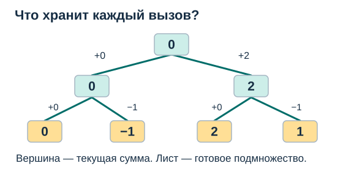

# Рекурсия и динамическое программирование

[Читать на сайте с интерактивами](https://yaroslav-yarik.github.io/cpm-robotics-programming/algorithms/recursion-and-dp.html).

[Оглавление](../README.md) · Базовые алгоритмы

## Рекурсия. Как перебрать все варианты

Найдём суммы всех подмножеств массива `[2, −1]`. Для каждого элемента есть два действия — пропустить его или взять. После выбора остаётся та же задача для оставшихся элементов. **Рекурсия** позволяет функции вызвать саму себя для этого более короткого остатка.

| Выбор для 2 | Выбор для −1 | Итоговая сумма |
|---|---|---:|
| Пропустить | Пропустить | 0 |
| Пропустить | Взять | −1 |
| Взять | Пропустить | 2 |
| Взять | Взять | 1 |



<!-- interactive -->

На рисунке видно всё дерево. Во время обхода в стеке хранятся только вызовы на пути от корня до текущей вершины. Каждый вызов хранит данные для возврата к предыдущему выбору. Длина этой цепочки не больше `n + 1`. Всего у дерева `2ⁿ` листьев.

Каждый вызов помнит две величины. Индекс показывает, какой элемент рассматриваем, а `subset_sum` хранит сумму уже взятых элементов. В первой ветви увеличиваем только индекс. Во второй прибавляем к сумме значение взятого элемента.

Когда индекс равен длине массива, выбора больше нет. Это **базовый случай**. Записываем сумму и завершаем вызов. Для пустого массива сразу запишем 0. Разные подмножества могут давать одинаковые суммы, поэтому в ответе возможны повторы.

Вариантов `2ⁿ`, поэтому время перебора составляет `O(2ⁿ)`. При `n = 30` это уже больше миллиарда вариантов. Для цепочки вызовов нужно `O(n)` памяти, для списка ответов — `O(2ⁿ)`. Если требуется только количество подходящих подмножеств, можно вместо списка накапливать счётчик.

**C++**

```cpp
#include <cstddef>
#include <vector>

using std::size_t;
using std::vector;

using Int = long long;
using Numbers = vector<Int>;

void visit_subsets(const Numbers& values, size_t index, Int subset_sum, Numbers& result) {
    if (index == values.size()) {
        result.push_back(subset_sum);
        return;
    }
    visit_subsets(values, index + 1, subset_sum, result);
    visit_subsets(values, index + 1, subset_sum + values[index], result);
}

Numbers subset_sums(const Numbers& values) {
    Numbers result;
    visit_subsets(values, 0, 0, result);
    return result;
}
```

<details>
<summary>Тот же алгоритм на Python</summary>

```python
def subset_sums(values):
    result = []

    def visit(index, subset_sum):
        if index == len(values):
            result.append(subset_sum)
            return
        visit(index + 1, subset_sum)
        visit(index + 1, subset_sum + values[index])

    visit(0, 0)
    return result
```

</details>

## Динамическое программирование. Как выбрать самый дешёвый путь

Перед лестницей стоит человек. За шаг он поднимается на одну или две ступеньки. Попадание на ступеньку `index` стоит `cost[index]`. Нужно оказаться на последней ступеньке и заплатить как можно меньше.

На ступеньку с индексом `index ≥ 2` можно попасть только со ступенек `index − 1` и `index − 2`. Зная наименьшую цену достижения двух предшествующих позиций, можно сразу вычислить лучшую цену для текущей. Такой способ получить ответ из ответов для меньших задач называется **динамическим программированием**.

Для цен `[5, 2, 10, 1]` получаем следующую таблицу.

| Позиция | Перед лестницей | 0 | 1 | 2 | 3 |
|---|---:|---:|---:|---:|---:|
| Цена посещения | — | 5 | 2 | 10 | 1 |
| Лучшая сумма до позиции | 0 | 5 | 2 | 12 | 3 |

Например, на ступеньку 2 можно попасть со ступеньки 0 или 1. Выбираем меньшую из сумм 5 и 2, прибавляем цену посещения 10 и получаем 12. На последнюю ступеньку выгоднее перейти сразу со ступеньки 1. Весь путь стоит `2 + 1 = 3`.

Для ступеньки 0 ответ равен её цене. Дальше работает правило **`dp[index] = cost[index] + min(dp[index − 1], dp[index − 2])`**. При `index = 1` позиция перед лестницей имеет цену 0. В коде её хранит отдельная переменная. Индекс `−1` в Python означал бы последний элемент списка.

Для следующего расчёта нужны лишь две предыдущие суммы — `cost_two_steps_back` и `previous_cost`. После каждого шага сдвигаем обе на одну позицию. Время работы составляет `O(n)`, дополнительная память — `O(1)`. Если лестница пуста, функция возвращает 0.

**C++**

```cpp
#include <algorithm>
#include <cstddef>
#include <vector>

using std::min;
using std::size_t;
using std::vector;

using Int = long long;
using Numbers = vector<Int>;

Int min_stair_cost(const Numbers& cost) {
    if (cost.empty()) return 0;
    Int cost_two_steps_back = 0, previous_cost = cost[0];
    for (size_t index = 1; index < cost.size(); ++index) {
        Int current_cost = cost[index] + min(cost_two_steps_back, previous_cost);
        cost_two_steps_back = previous_cost;
        previous_cost = current_cost;
    }
    return previous_cost;
}
```

<details>
<summary>Тот же алгоритм на Python</summary>

```python
def min_stair_cost(cost):
    if not cost:
        return 0
    cost_two_steps_back, previous_cost = 0, cost[0]
    for index in range(1, len(cost)):
        current_cost = cost[index] + min(cost_two_steps_back, previous_cost)
        cost_two_steps_back, previous_cost = previous_cost, current_cost
    return previous_cost
```

</details>

---

[← Обходы клеточной карты](grid-traversal.md)
