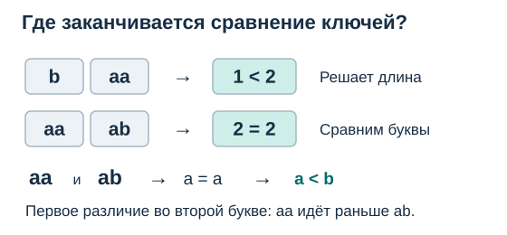

# Сортировка и ключи

[Читать на сайте с интерактивами](https://yaroslav-yarik.github.io/cpm-robotics-programming/algorithms/sorting.html).

[Оглавление](../README.md) · Базовые алгоритмы

## Как задать порядок по двум признакам

Упорядочим слова `aa, b, ab, a` по длине. Что делать с `aa` и `ab`? Их длины равны, поэтому добавим второе правило. Среди слов одной длины раньше идёт лексикографически меньшее. Для строчных латинских букв это обычный словарный порядок.

| Слово | Ключ (длина, слово) | Место в результате |
|---|---|---:|
| `aa` | `(2, "aa")` | 3 |
| `b` | `(1, "b")` | 2 |
| `ab` | `(2, "ab")` | 4 |
| `a` | `(1, "a")` | 1 |



<!-- interactive -->

Длину объекта `std::string` можно узнать за постоянное время. Для двух слов равной длины приходится учитывать и содержимое памяти. Чем длиннее общий префикс, тем больше байтов может понадобиться проверить. Реализация иногда сравнивает сразу несколько байтов одной инструкцией.

Получается `a, b, aa, ab`. В примере используются буквы ASCII. В строке UTF-8 C++ считает байты, а Python при вычислении `len` считает кодовые точки Unicode. Для кириллицы эти величины уже различаются.

## Как записать правило в коде

В Python функция `key` строит для каждого слова пару. При сравнении пар сначала сравниваются длины. Если длины совпали, сравниваются слова. Функция `sorted` возвращает новый список.

В C++ функция сравнения (**компаратор**) отвечает на вопрос «Должно ли первое слово стоять раньше второго?». Для одинаковых слов ответ всегда `false`, поэтому в компараторе нужен знак `<`. Функция принимает вектор по значению, сортирует свою копию и возвращает её.

**C++17**

```cpp
#include <algorithm>
#include <string>
#include <vector>

using std::sort;
using std::string;
using std::vector;

vector<string> by_length(vector<string> words) {
    sort(words.begin(), words.end(), [](const auto& left_word, const auto& right_word) {
        if (left_word.size() != right_word.size()) return left_word.size() < right_word.size();
        return left_word < right_word;
    });
    return words;
}
```

<details>
<summary>Тот же алгоритм на Python</summary>

```python
def by_length(words):
    return sorted(words, key=lambda word: (len(word), word))
```

</details>

## Когда важен исходный порядок

При сортировке только по длине слова `aa` и `ab` имеют одинаковый ключ. **Стабильная сортировка** оставит их в том порядке, в котором они встретились на входе. В Python `sorted` стабильна. В C++ для такой задачи есть `std::stable_sort`.

Сортировке требуется `O(n log n)` сравнений в худшем случае. Если одно сравнение слов длиной до `L` занимает `O(L)`, общая верхняя оценка времени на сравнения — `O(n log n · L)`.

---

[← Сложность и перебор](complexity-and-brute-force.md) · [→ Двоичный поиск](binary-search.md)
