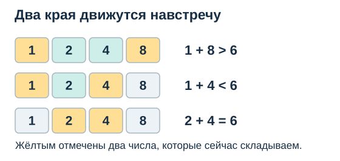

# Два указателя и скользящее окно

[Читать на сайте с интерактивами](https://yaroslav-yarik.github.io/cpm-robotics-programming/algorithms/two-pointers-and-window.html).

[Оглавление](../README.md) · Базовые алгоритмы

## Как найти пару с заданной суммой

Нужны два числа на разных позициях, дающие в сумме 6. Возьмём **отсортированный массив** `[1, 2, 4, 8]`. Один указатель поставим на первый элемент, другой — на последний. Здесь указатели — это два индекса, `left` и `right`.

| Числа на краях | Сумма | Следующий шаг |
|---|---:|---|
| 1 и 8 | 9 | Убираем 8. Даже с наименьшим числом сумма слишком велика |
| 1 и 4 | 5 | Убираем 1. Даже с наибольшим оставшимся числом суммы не хватает |
| 2 и 4 | 6 | Пара найдена |



<!-- interactive -->

В векторе C++ элементы расположены подряд. Оба края последовательно читают соседние адреса. Когда несколько соседних чисел попадают в одну строку кэша, после первого чтения следующие числа могут уже находиться рядом с процессором.

Если индексы встретились, осталась одна позиция и составить пару уже нельзя. Каждый шаг сдвигает одну границу внутрь, поэтому время поиска составляет `O(n)`, дополнительная память — `O(1)`. Если массив сначала приходится сортировать, общее время возрастает до `O(n log n)`.

**C++**

```cpp
#include <cstddef>
#include <vector>

using std::size_t;
using std::vector;

using Int = long long;
using Numbers = vector<Int>;

bool pair_sorted(const Numbers& values, Int target) {
    if (values.size() < 2) return false;
    size_t left = 0, right = values.size() - 1;
    while (left < right) {
        Int current_sum = values[left] + values[right];
        if (current_sum == target) return true;
        if (current_sum < target) ++left;
        else --right;
    }
    return false;
}
```

<details>
<summary>Тот же алгоритм на Python</summary>

```python
def pair_sorted(values, target):
    left, right = 0, len(values) - 1
    while left < right:
        current_sum = values[left] + values[right]
        if current_sum == target:
            return True
        if current_sum < target:
            left += 1
        else:
            right -= 1
    return False
```

</details>

## Как найти самый длинный участок с ограниченной суммой

Пусть все числа и предел суммы **неотрицательны**. Окном будем называть непрерывный участок массива между границами `left` и `right` включительно. При расширении вправо прибавляем новый элемент к сумме. Пока сумма больше предела, убираем элементы слева.

Для массива `[1, 2, 1, 0, 4]` и предела 3 окно меняется так.

| Добавили справа | Что убрали слева | Оставшееся окно | Сумма |
|---:|---|---|---:|
| 1 | — | `[1]` | 1 |
| 2 | — | `[1, 2]` | 3 |
| 1 | 1 | `[2, 1]` | 3 |
| 0 | — | `[2, 1, 0]` | 3 |
| 4 | 2, 1, 0 и 4 | `[]` | 0 |

Самое длинное допустимое окно — `[2, 1, 0]`, его длина равна 3. Удалённые элементы можно больше не рассматривать. Если с некоторым началом сумма уже велика, то добавление неотрицательных чисел справа её только сохранит или увеличит.

Каждый элемент добавляем один раз и удаляем не более одного раза. Поэтому два вложенных цикла вместе занимают `O(n)` времени и используют `O(1)` дополнительной памяти.

С отрицательными числами это рассуждение перестаёт работать. В массиве `[4, −2]` при пределе 3 алгоритм сразу удалил бы четвёрку, хотя сумма всего массива равна 2.

**C++**

```cpp
#include <algorithm>
#include <cstddef>
#include <vector>

using std::max;
using std::size_t;
using std::vector;

using Int = long long;
using Numbers = vector<Int>;

size_t longest_at_most(const Numbers& values, Int limit) {
    size_t left = 0, best_length = 0;
    Int current_sum = 0;
    for (size_t right = 0; right < values.size(); ++right) {
        current_sum += values[right];
        while (current_sum > limit) {
            current_sum -= values[left];
            ++left;
        }
        best_length = max(best_length, (right + 1) - left);
    }
    return best_length;
}
```

<details>
<summary>Тот же алгоритм на Python</summary>

```python
def longest_at_most(values, limit):
    left = current_sum = best_length = 0
    for right, value in enumerate(values):
        current_sum += value
        while current_sum > limit:
            current_sum -= values[left]
            left += 1
        best_length = max(best_length, right - left + 1)
    return best_length
```

</details>

---

[← Префиксные суммы](prefix-sums.md) · [→ Частоты](frequencies.md)
