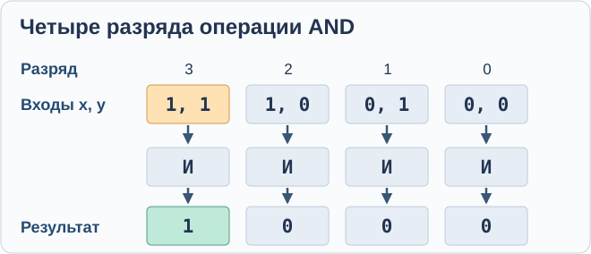

# Биты, маски и std::bitset

[Читать на сайте с интерактивами](https://yaroslav-yarik.github.io/cpm-robotics-programming/cpp/bits-and-bitset.html).

[Оглавление](../README.md) · Язык C++

Бит принимает одно из двух значений, 0 или 1. Несколько битов подряд могут обозначать число. Чтобы прочитать его, сложи веса всех позиций, в которых стоит единица.

| Номер позиции | 3 | 2 | 1 | 0 |
|---|---:|---:|---:|---:|
| Вес | 8 | 4 | 2 | 1 |
| Биты числа 13 | 1 | 1 | 0 | 1 |

Позиции нумеруются справа налево с нуля. В числе `1101` единицы стоят на позициях 3, 2 и 0, поэтому его значение равно `8 + 4 + 1 = 13`. В C++ префикс `0b` обозначает двоичную запись числа, а `0x` — шестнадцатеричную.

## Побитовые операции

| Выражение | Когда бит результата равен 1 | Для `left_bits = 0b1100` и `right_bits = 0b1010` |
|---|---|---|
| `left_bits & right_bits` | Оба входных бита равны 1 | `0b1000` |
| `left_bits \| right_bits` | Хотя бы один входной бит равен 1 | `0b1110` |
| `left_bits ^ right_bits` | Входные биты различаются | `0b0110` |
| `~left_bits` | Бит `left_bits` равен 0 | Младшие четыре бита равны `0011`, остальные биты тоже меняются |

Например, чтобы вычислить `1100 & 1010`, сравни два числа по столбцам. Только в крайнем левом столбце стоят две единицы. Получится `1000`.

**Как операция И выглядит в железе.** Логический элемент И принимает два электрических сигнала. Уровни напряжения кодируют 0 и 1. Если оба входа кодируют единицу, выход тоже кодирует единицу. Для целого числа одинаковое правило применяется отдельно в каждом разряде.



<!-- interactive -->

Между соседними столбцами нет переноса. Такую операцию над машинным словом обычно выполняет арифметико-логическое устройство процессора за одну команду AND. Рисунок показывает четыре младших разряда для удобства чтения. [Как устроен процессор](../hardware/cpu.md).

Операторы `&&`, `||` и `!` определяют истинность целого выражения. Например, `2 && 1` даёт `true`, а `2 & 1` даёт 0, потому что у этих чисел нет общих установленных битов. Запись `^` обозначает исключающее ИЛИ. В C++ она не возводит в степень.

## Сдвиги и отдельные биты

Для беззнаковых чисел сдвиги заполняют освободившиеся разряды нулями. Сдвиг `number << position` перемещает биты в сторону больших весов и отбрасывает старшие биты, которым не хватило места. Когда потерь нет, это умножение на 2 в степени `position`. Сдвиг `number >> position` равен целочисленному делению на ту же степень двойки. Например, `13u << 1` равно 26, а `13u >> 1` равно 6.

**Маска** — число, у которого единицами отмечены интересующие нас позиции. Если нужен только бит 1, берём число `0001` и сдвигаем его влево на одну позицию. Получится `0010`.

В примерах `1ULL` имеет тип `unsigned long long`. Выбирай `position` от 0 до 63, чтобы сдвиг гарантированно помещался в ширину этого типа на любой реализации.

Для ширины в конкретном окружении есть `std::numeric_limits<unsigned long long>::digits` из `<limits>`. Сдвиг на отрицательное число или на число, равное ширине типа после целочисленных продвижений или больше, недопустим. Тип левого операнда важен. В выражении `1 << position` сдвигается `int`, даже если результат присваивается широкой переменной.

```cpp
unsigned long long flags = 0b1101;
unsigned position = 1;
auto mask = 1ULL << position;      // Маска из одной единицы: 0010.

bool was_set = (flags & mask) != 0;  // false: второй справа бит выключен.
flags |= mask;                       // 1111: включить выбранный бит.
flags &= ~mask;                      // 1101: выключить только этот бит.
flags ^= mask;                       // 1111: переключить выбранный бит.
auto selected_bit = (flags >> position) & 1ULL;   // 1: выбранный бит перемещён на позицию 0.
```

Скобки в `(flags & mask) != 0` задают нужный порядок: сначала применить маску, затем сравнить с нулём. Если требуется проверить сразу несколько флагов, `(flags & mask) != 0` означает «установлен хотя бы один», а `(flags & mask) == mask` — «установлены все». Например, маска `0b1010` проверяет биты 1 и 3.

## Подсчёт единиц

Для положительного `number` число `number - 1` меняет младшую единицу на ноль, а стоящие справа нули — на единицы. Поэтому `number & (number - 1)` убирает ровно младшую единицу. Например, из `0b101100` получится `0b101000`.

```cpp
int count_ones(unsigned long long number) {
    int count = 0;
    while (number != 0) {
        number &= number - 1;
        ++count;
    }
    return count;
}
// count_ones(0b101100) даёт 3, count_ones(0) даёт 0.
```

Цикл работает столько итераций, сколько в исходном числе единиц. В C++20 доступен `std::popcount(number)` из `<bit>` для беззнаковых типов.

## Набор битов фиксированной длины

Тип `std::bitset<N>` из `<bitset>` хранит ровно `N` битов. Размер известен при компиляции. Например, `std::bitset<8>(13)` хранит `00001101`. Конструирование из целого использует младшие `N` битов. В записи для человека старший бит слева, а индекс 0 по-прежнему обозначает крайний бит справа.

```cpp
#include <bitset>
#include <iostream>

using std::bitset;
using std::cout;

int main() {
    bitset<8> before(0b00001101);
    bitset<8> after("00000111");
    auto changed = before ^ after;  // Единицы в местах изменений.

    cout << changed << '\n';          // 00001010
    cout << changed.count() << '\n';  // 2
    cout << changed.test(3) << '\n';  // 1

    changed.reset(3);   // 00000010
    changed.set(0);     // 00000011
    changed.flip(1);    // 00000001
    cout << changed.to_ullong() << '\n';  // 1
}
```

В строках `00001101` и `00000111` различаются биты 3 и 1. Поэтому результат XOR равен `00001010`, а `count()` возвращает 2.

| Что нужно узнать или изменить | Метод |
|---|---|
| Бит на позиции `i` | `test(i)` проверяет границы. `b[i]` подходит для заведомо допустимого индекса |
| Есть единицы? Все биты нулевые? Все единичные? | `any()`, `none()`, `all()` соответственно |
| Поставить 1, поставить 0 или переключить бит | `set(i)`, `reset(i)`, `flip(i)` |
| Сделать то же для всех позиций | `set()`, `reset()`, `flip()` |

Два набора одинакового размера можно объединять через `&`, `|`, `^`. Сдвиг на `N` позиций и больше даёт нулевой набор. `to_string()` сохраняет все `N` разрядов, включая ведущие нули. `to_ullong()` выбрасывает `std::overflow_error`, когда значение слишком велико для результата.

---

[← Преобразование и редактирование последовательностей](sequence-operations.md)
