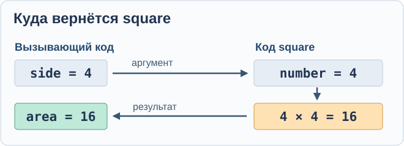

# Функции, ссылки и указатели

[Читать на сайте с интерактивами](https://yaroslav-yarik.github.io/cpm-robotics-programming/cpp/functions-and-pointers.html).

[Оглавление](../README.md) · Язык C++

Функция — именованная часть программы, которую можно вызвать. Например, `square(4)` означает «вызвать функцию `square` и передать ей число 4». Чтобы воспользоваться результатом, его можно присвоить переменной.

## Передача по значению

В вызове `square(4)` параметр `number` получает значение 4. Функция возвращает 16. Если вызвать `square(x)`, внутри функции появляется собственный параметр с копией значения `x`. Присваивание параметру не меняет `x` в вызывающем коде.

```cpp
int square(int number) {
    return number * number;
}
```

```cpp
int side = 4;
int area = square(side);  // area получает 16, side по-прежнему равно 4.
```

В объявлении `int square(int number)` первый `int` задаёт тип результата, а `int number` объявляет параметр. При вызове значение аргумента `side` копируется в `number`.

В примере предполагается, что результат помещается в `int`. `return` заканчивает работу функции и передаёт результат. Если функция только выполняет действие, можно объявить её с результатом `void`. Тогда `return;` означает «закончить работу сейчас».

**Как процессор вызывает функцию.** Если `square` вызывается отдельной командой, процессору понадобятся две вещи — значение аргумента и адрес команды, с которой продолжить работу после возврата. На многих платформах маленький аргумент передают в регистре. Функция умножает число, оставляет результат в оговорённом регистре и возвращает управление вызывающему коду.



Компилятор также может подставить тело `square` прямо на место вызова. Такое преобразование называют *встраиванием*. Тогда переход к функции и обратный переход исчезают, а результат для `side = 4` остаётся равен 16.

## Ссылка и изменение исходной переменной

Ссылка — другое имя уже существующего объекта. В записи `int& alias = value;` выражения `alias` и `value` обозначают один и тот же `int`. Если записать `alias = 5;`, значение `value` тоже будет 5.

Таким же способом работает параметр-ссылка. Если у функции параметр `int& value`, то внутри функции имя `value` обозначает переданную переменную.

```cpp
void add_bonus(int& score) {
    score += 5;
}
```

```cpp
int points = 10;
add_bonus(points);  // Теперь points равно 15.
```

При таком вызове `score` внутри функции и `points` снаружи обозначают одну переменную. Вызов `add_bonus(10)` не скомпилируется. Нужна изменяемая переменная, а у литерала 10 такой переменной нет. Ссылку создают сразу с начальным объектом. Позднее присваивание меняет значение объекта, к которому она относится.

Для чтения можно использовать ссылку на константу, например `const std::string& name`. Она позволяет обратиться к строке без копирования и запрещает менять строку через этот параметр. Для маленького числа вроде `int` обычно проще передать значение.

<!-- interactive -->

## Адрес и указатель

У объекта есть адрес. Его можно представить как номер ячейки, по которому программа находит объект. Указатель хранит адрес. В выражении `&score` знак `&` означает «получить адрес переменной `score`».

| Запись | Читаем так |
|---|---|
| `int* address = &score;` | `address` хранит адрес переменной типа `int` |
| `*address` | Объект по этому адресу |
| `*address = 20;` | Записать 20 в объект по этому адресу |
| `&address` | Адрес самой переменной-указателя. Его тип `int**` |

В объявлении `int* address` звёздочка относится к типу. В выражении `*address` она означает **разыменование**. Запись `address = &other;` меняет адрес, который хранит указатель. Запись `*address = other;` оставляет адрес прежним и копирует значение в объект по этому адресу.

## Как передача аргумента меняет результат

```cpp
#include <iostream>

using std::cout;

// Функции square и add_bonus определены выше.

void swap_scores(int* left, int* right) {
    // Оба указателя должны указывать на существующие int.
    int saved = *left;
    *left = *right;
    *right = saved;
}

int main() {
    int first = 10;
    int second = 20;

    cout << square(first) << ' ' << first << '\n';  // 100 10
    add_bonus(first);
    cout << first << '\n';                         // 15
    swap_scores(&first, &second);
    cout << first << ' ' << second << '\n';         // 20 15
}
```

| После операции | `first` | `second` | `saved` внутри функции |
|---|---:|---:|---:|
| `add_bonus(first)` | 15 | 20 | — |
| `int saved = *left` | 15 | 20 | 15 |
| `*left = *right` | 20 | 20 | 15 |
| `*right = saved` | 20 | 15 | 15 |

При вызове `swap_scores` адреса копируются в параметры `left` и `right`. Эти копии адресов по-прежнему ведут к исходным переменным. Поэтому присваивания `*left` и `*right` меняют `first` и `second`. Для такого обмена в обычном C++ также есть `std::swap` из `<utility>`.

## Время жизни

Разыменовывай указатель, только если известно, что он указывает на существующий объект. Для обозначения отсутствующего адреса используется `nullptr`. Проверка `p != nullptr` полезна, когда по договорённости указатель либо действительный, либо пустой.

**Висячий указатель** хранит адрес объекта, время жизни которого уже закончилось. Проверка на `nullptr` такой указатель не распознаёт.

Объявление `int* p;` само по себе не связывает `p` с переменной. Указатель на локальный объект с автоматическим временем жизни становится непригоден для разыменования после выхода из блока, где этот объект объявлен. Поэтому, если результат функции хранится в локальной переменной `int result = 42;`, возвращай само значение командой `return result;`.

## Перегрузка и аргументы по умолчанию

**Перегрузка** позволяет дать одно имя функциям с разными наборами параметров. Для `print(int)` и `print(double)` вызов `print(2)` выберет первую, а `print(2.0)` — вторую. Одного различия в возвращаемом типе для перегрузки недостаточно.

**Аргумент по умолчанию** можно указать в объявлении, например `int add(int value, int bonus = 5);`. Вызов `add(10)` будет передавать второй аргумент 5. Вызов `add(10, 2)` передаст 2.

---

[← Как устроена память](memory-layout.md) · [→ Массивы, векторы и итераторы](arrays-and-vectors.md)
