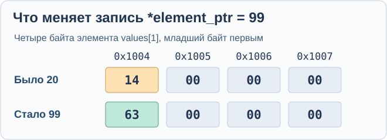

# Как устроена память

[Читать на сайте с интерактивами](https://yaroslav-yarik.github.io/cpm-robotics-programming/cpp/memory-layout.html).

[Справочник](../README.md) › Язык C++

Мы уже умеем читать значение по имени. Теперь посмотрим, как найти его по **адресу**. Для этого удобно взять массив. Его элементы в C++ гарантированно лежат подряд.

## От индекса к адресу

```cpp
int values[3] = {10, 20, 30};
```

У каждого байта памяти есть адрес. Предположим, что массив начинается по адресу `0x1000`, а один `int` занимает четыре байта. Тогда весь массив займёт 12 байтов. Префикс `0x` означает шестнадцатеричную запись числа.

| | Первый элемент | Второй элемент | Третий элемент |
|---|---|---|---|
| Элемент массива | `values[0]` | `values[1]` | `values[2]` |
| Значение | 10 | 20 | 30 |
| Адрес первого байта | `0x1000` | `0x1004` | `0x1008` |
| Адрес последнего байта | `0x1003` | `0x1007` | `0x100B` |

От первого элемента до третьего — два шага по четыре байта. Поэтому адрес третьего элемента на восемь байтов больше начального. Для отдельно объявленных переменных порядок размещения язык не задаёт.

Размер своего типа можно узнать через `sizeof(int)`. Он зависит от платформы. `sizeof(char)` всегда равен одному байту. Обычно в байте восемь битов. Точное число даёт `CHAR_BIT` из `<climits>`.

## Как изменить элемент через указатель?

**Указатель** хранит адрес. Оператор `&` позволяет получить адрес объекта, а `*` перед именем указателя даёт доступ к объекту по этому адресу.

```cpp
int values[3] = {10, 20, 30};
int* element_ptr = &values[0];
element_ptr = &values[1];
*element_ptr = 99;
```

| После строки | Куда указывает `element_ptr` | Содержимое массива |
|---|---|---|
| `int* element_ptr = &values[0];` | на первый элемент | 10, 20, 30 |
| `element_ptr = &values[1];` | на второй элемент | 10, 20, 30 |
| `*element_ptr = 99;` | на второй элемент | 10, **99**, 30 |

Проследи последнюю запись по адресам из таблицы выше.

```text
element_ptr хранит 0x1004  ───→  values[1] по адресу 0x1004
                                 было 20, записали 99
```

Если `int` занимает четыре восьмибитных байта, то запись в `*element_ptr` задаёт новое значение всех четырёх байтов элемента. На рисунке числа записаны в шестнадцатеричной системе. У 20 младший байт равен `14`, у 99 он равен `63`. Три старших байта и до, и после записи нулевые.



<!-- interactive -->

Для процессора это может быть одна команда записи четырёх байтов по адресу. Во многих компьютерах новое значение сначала попадает в **кэш** — небольшую быструю память, где процессор держит недавно использованные данные. Момент, когда изменится содержимое микросхемы ОЗУ, из строки C++ определить нельзя. [Как связаны кэш и оперативная память](../hardware/memory.md).

## Сколько времени живут данные?

Вызовы функций на обычной платформе используют **стек**. При каждом вызове появляется место для локальных данных и служебной информации. Часть значений компилятор может держать в регистрах. Для программиста важно время жизни объекта. Обычная локальная переменная существует с момента её создания до выхода из блока.

```cpp
#include <vector>

using std::vector;

void example() {
    vector<int> values(1000, 0);
    values[0] = 7;
}
```

У вектора есть две части. Сам объект `values` создан внутри функции. Тысяча элементов лежит подряд в отдельной области **динамической памяти**, которую часто называют кучей. Объект вектора управляет этой областью и освобождает её при выходе из функции.

```text
Локальный объект              Динамическая память
values                 ───→   [7][0][0] … [0]
                              1000 элементов int
```

Поэтому `sizeof(values)` даёт размер самого объекта вектора. Для его 1000 текущих элементов требуется ещё `values.size() * sizeof(int)` байтов. Вектор может держать запас места и для следующих элементов.

**Область видимости** определяет, где в коде доступно имя. **Время жизни** определяет, когда существует сам объект. Например, локальная переменная с `static` сохраняет своё значение между вызовами функции, хотя имя доступно только внутри блока. Если после уничтожения объекта остался указатель на него, он стал *висячим*. Читать или менять объект через такой указатель нельзя.

## В каком порядке лежат байты одного числа?

Возьмём 32-битное беззнаковое число `0x12345678`. При восьми битах в байте каждая пара шестнадцатеричных цифр занимает один байт. Какую пару мы увидим по первому адресу, зависит от порядка байтов на машине.

| Адрес | `0x1000` | `0x1001` | `0x1002` | `0x1003` |
|---|---|---|---|---|
| Младший байт первым (*little-endian*) | `78` | `56` | `34` | `12` |
| Старший байт первым (*big-endian*) | `12` | `34` | `56` | `78` |

В обоих случаях значение числа одно и то же. Разницу видно при чтении его представления по одному байту. На обычной ОС программа работает с виртуальными адресами. По такому адресу нельзя определить положение байта на физической планке памяти.

**Подробнее об адресах и типах.** [Stanford CS106L, Introduction to Pointers (2008)](https://web.stanford.edu/class/archive/cs/cs106b/cs106b.1084/cs106l/handouts/050_Pointers.pdf) · [Бьёрн Страуструп, A Tour of C++, 2-е издание (2018)](https://www.stroustrup.com/tour2.html)

---

[← Что такое переменная](variables-and-memory.md) · [Функции, ссылки и указатели →](functions-and-pointers.md)
