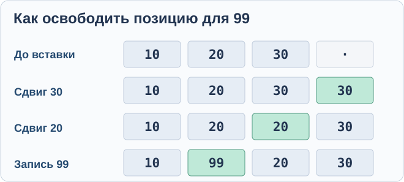

# Преобразование и редактирование последовательностей

[Читать на сайте с интерактивами](https://yaroslav-yarik.github.io/cpm-robotics-programming/cpp/sequence-operations.html).

[Оглавление](../README.md) · Язык C++

Пусть в векторе стоят числа `10, 20, 30`. Чтобы поместить `99` между первым и вторым числами, нужно указать позицию **перед** `20`. В C++ эту позицию задаёт итератор `values.begin() + 1`.

## Вставка и удаление по позиции

Пусть `values` — вектор, а `pos` — допустимый итератор в нём.

| Запись | Результат |
|---|---|
| `values.push_back(value)` | Дописывает значение в конец |
| `values.insert(pos, value)` | Вставляет значение перед позицией `pos` |
| `values.insert(pos, count, value)` | Вставляет `count` копий |
| `values.insert(pos, b.begin(), b.end())` | Вставляет все элементы другого вектора `b` |
| `values.erase(pos)` | Удаляет элемент в позиции `pos` |
| `values.erase(first, last)` | Удаляет полуинтервал `[first, last)` |

Вставка перед `end()` дописывает в конец. Сам `end()` нельзя удалить как элемент. Посмотрим, как меняются позиции при двух правках подряд.

```cpp
#include <vector>

using std::vector;

vector<int> values{10, 20, 30};
values.insert(values.begin() + 1, 99);  // 10, 99, 20, 30
values.erase(values.begin() + 1, values.begin() + 3);  // 10, 30
```

При удалении левая граница указывает на `99`, правая — на `30`. Элемент на правой границе сохраняется.

**Почему вставка в середину требует работы.** Представим, что в буфере вектора есть место для четвёртого числа. На рисунке точка обозначает запас места за последним элементом. Чтобы освободить вторую позицию, достаточно сдвинуть хвост на одну позицию вправо, начиная с конца. Если первым переписать 30 числом 20, прежнее значение 30 будет потеряно.



<!-- interactive -->

На уровне памяти это перенос содержимого соседних ячеек. Для простых типов библиотека может перемещать сразу блок байтов. Если свободной позиции за концом нет, вектор получает более вместительный буфер и размещает элементы уже в нём. [Как размещаются данные](../hardware/memory.md).

При вставке в середину и удалении могут сдвигаться многие элементы. Если вектор перераспределил память, старые итераторы и ссылки на его элементы недействительны. При `erase` становятся недействительными итераторы и ссылки на удалённые и последующие позиции. Для учебных примеров безопасное правило простое: после изменения вектора вычисляй позиции заново.

В цикле, который удаляет по итератору, продолжай с результата `it = values.erase(it)`, если ты удалил элемент, и делай `++it` только в ветке, где его сохранил. Для удаления многих элементов по условию эффективнее сделать один проход с `remove_if`.

## Копирование и преобразование

`std::copy` копирует исходный диапазон. `std::transform` вызывает функцию для каждого элемента и записывает результат. Алгоритмы сами не знают размер вектора назначения. Вызов `std::back_inserter(result)` из `<iterator>` создаёт итератор, запись в который вызывает `result.push_back(...)`.

- `copy(..., result.begin())` требует, чтобы в `result` уже было достаточно элементов для записи.
- `copy(..., std::back_inserter(result))` дописывает в существующий вектор.
- `transform(..., std::back_inserter(result), f)` дописывает преобразованные значения.
- Конструктор `std::vector<int> part(values.begin(), values.begin() + 2);` сразу создаёт копию первых двух элементов, если они есть.

Если вызвать `copy` с `back_inserter`, а затем `transform` с тем же выходным вектором, преобразованные значения добавятся после уже скопированных.

## Как удалить соседние повторы

`std::unique` оставляет по одному элементу от каждой **соседней** группы равных. Для `{4, 4, 2, 4}` полезная часть станет `{4, 2, 4}`. Длина вектора остаётся прежней. Алгоритм возвращает новый конец полезной части. Поэтому обычно пишут:

```cpp
#include <algorithm>

using std::unique;

values.erase(unique(values.begin(), values.end()), values.end());
```

Если нужны все разные числа и изменение порядка допустимо, сначала отсортируй вектор: тогда равные числа окажутся рядом.

## Как удалить элементы по условию

С `remove_if` похожий принцип. Алгоритм сдвигает вперёд элементы, которые надо сохранить, а хвост удаляет сам вектор:

```cpp
#include <algorithm>

using std::remove_if;

values.erase(remove_if(values.begin(), values.end(),
                       [](int value) { return value < 0; }),
        values.end());
```

Чтобы убрать точное значение `x`, в таком же шаблоне используй `std::remove(values.begin(), values.end(), x)`. Начиная с **C++20**, для вектора можно написать `std::erase(values, x)` или `std::erase_if(values, pred)`. Это свободные функции, а `values.erase(pos)` — метод вектора. Для решения под C++17 используй два предыдущих шаблона.

## Как сложить элементы

`std::accumulate(first, last, initial)` из `<numeric>` последовательно прибавляет элементы к начальному значению. Тип начального значения задаёт тип суммы. Для суммы больших `int` пиши `0LL`, если сумма помещается в `long long`. Запись `long long sum = std::accumulate(..., 0);` сначала считает в `int`, и позднее преобразование не защищает от переполнения.

## Преобразование измерений и сумма

Оставим одно число из каждой соседней группы и удалим отрицательные числа. Потом сохраним очищенный ряд и допишем квадраты в тот же выходной вектор.

```cpp
#include <algorithm>
#include <iostream>
#include <iterator>
#include <numeric>
#include <vector>

using std::accumulate;
using std::back_inserter;
using std::copy;
using std::cout;
using std::remove_if;
using std::transform;
using std::unique;
using std::vector;

int main() {
    vector<int> values{2, 2, -5, 3, 3, 2};
    values.erase(unique(values.begin(), values.end()), values.end());
    values.erase(remove_if(values.begin(), values.end(),
                                [](int value) { return value < 0; }),
                 values.end());

    vector<long long> result;
    copy(values.begin(), values.end(), back_inserter(result));
    transform(values.begin(), values.end(), back_inserter(result),
                   [](int value) { return 1LL * value * value; });

    for (long long value : result) {
        cout << value << ' ';
    }
    cout << '\n' << accumulate(result.begin(), result.end(), 0LL) << '\n';
}
```

| Шаг | Что получилось |
|---|---|
| Сжали соседние повторы | `2, -5, 3, 2` |
| Убрали отрицательные числа | `2, 3, 2` |
| Скопировали числа в `result` и дописали их квадраты | `2, 3, 2, 4, 9, 4` |
| Сложили все элементы `result` | `24` |

Порядок действий имеет значение. После удаления отрицательных элементов соседними могут стать числа, которые раньше разделял удалённый элемент. Если нужно схлопнуть и такие новые группы, вызывай `unique` после фильтрации.

---

[← Алгоритмы стандартной библиотеки и лямбды](stl-and-lambdas.md) · [→ Биты, маски и std::bitset](bits-and-bitset.md)
