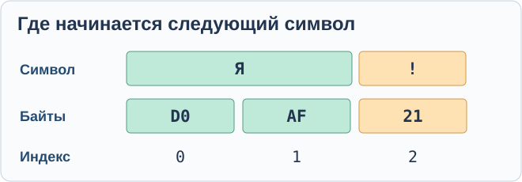

# Строки

[Оглавление](../README.md) · Язык C++

Строка `std::string` хранит последовательность элементов типа `char`. В слове `robot` пять букв. Чтобы получить третью, укажи индекс 2.

| Индекс | 0 | 1 | 2 | 3 | 4 |
|---|---|---|---|---|---|
| `word[i]` | `r` | `o` | `b` | `o` | `t` |

## Создание и ввод строки

Для `std::string` нужен заголовок `<string>`. Одинарные кавычки обозначают символ: `'a'`. Двойные — строковый литерал: `"abc"`.

```cpp
std::string word = "robot";
std::string line;
std::cin >> word;                // Одно слово до пробела.
std::getline(std::cin, line);     // Остаток текущей строки.
```

Если ввести `blue sky`, то `word` получит `"blue"`, а `line` — `" sky"` с пробелом в начале. Если сразу после слова нажать Enter, `line` будет пустой.

После `std::cin >> number` символ конца строки остаётся во входном потоке. Если нужно читать **следующую** строку, сначала убери остаток текущей. Например, если число стоит отдельно на своей строке:

```cpp
// Заголовки <iostream>, <limits> и <string>.
int number;
std::string line;
if (std::cin >> number) {
    std::cin.ignore(std::numeric_limits<std::streamsize>::max(), '\n');
    std::getline(std::cin, line);
}
```

Такой вариант сохраняет начальные пробелы и пустую следующую строку. Если остаток строки после числа тоже нужен, не отбрасывай его.

## Чтение и изменение символов

Разберём операции на строке `s = "robot"`. Каждая строка таблицы начинается с этого исходного значения.

| Запись | Результат |
|---|---|
| `s.size()` | 5 |
| `s[0]` | Символ `'r'` |
| `s.at(1) = 'u';` | `"rubot"` |
| `s + " arm"` | Строка `"robot arm"`. Сама `s` сохраняет своё значение |
| `s.append(" arm");` | `s` становится `"robot arm"` |
| `s.push_back('!');` | `"robot!"` |
| `s.pop_back();` | `"robo"` |
| `s.substr(1, 3)` | Копия участка `"obo"` |
| `s.insert(2, "X");` | `"roXbot"` |
| `s.erase(1, 2);` | `"rot"` |
| `s.replace(1, 2, "AA");` | `"rAAot"` |

В `substr(pos, count)`, `erase(pos, count)` и `replace(pos, count, text)` второй аргумент — число символов. Если нужна подстрока с индексами от `left` до `right` включительно, количество символов равно `right - left + 1`. Обращайся к символам только при индексе меньше `s.size()`, а `pop_back()` вызывай для непустой строки. После правок строки проще получить итераторы заново.

У обычной `std::string` индекс обозначает элемент типа `char`. Для ASCII-строки это отдельный символ. В UTF-8 одна русская буква может занимать несколько элементов, поэтому посимвольные примеры здесь используют ASCII.

**Что именно читает процессор.** Возьмём строку `u8"Я!"` в C++17 на компьютере с восьмибитным байтом. Текст содержит два символа, а `std::string s = u8"Я!";` сохраняет три байта текста. Буква «Я» записана двумя байтами UTF-8, затем идёт байт восклицательного знака. В схеме значения байтов указаны в шестнадцатеричной системе.



Команда чтения `s[1]` обращается ко второму байту буквы «Я». Чтобы найти начало следующего символа, программе нужно учесть правила UTF-8. При чтении байта процессор сам буквы не распознаёт.

## Поиск подстроки

`s.find("ab")` возвращает индекс начала первого совпадения. `s.rfind("ab")` при вызове без начальной позиции ищет последнее совпадение. Если соответствующего участка нет, возвращается `std::string::npos`.

```cpp
auto pos = s.find("ab", 2);  // Искать начиная с индекса 2.
if (pos != std::string::npos) {
    std::cout << pos << '\n';
}
```

Используй `auto` или `std::string::size_type` для позиции и сравнивай с `npos` до обращения к строке. В двухаргументном вызове второй аргумент — начальная позиция поиска.

В перегрузке с символьным массивом `s.find("abcd", 1, 2)` поиск стартует с индекса 1, а третий аргумент говорит взять первые два символа **образца**. То есть здесь ищем `"ab"`.

### Число и его десятичная запись

`std::to_string(42)` возвращает `"42"`. `std::stoi("42")` возвращает целое 42. `stoi` умеет прочитать начальную числовую часть: для `"42cm"` результат тоже будет 42. Если нужен контроль, передай адрес переменной `std::size_t used` вторым аргументом и проверь, что `used == text.size()` для непустой входной строки. При отсутствии читаемого числа или выходе за границы `int` функция выбрасывает исключение.

### Сортировка

По итераторам строки работают `sort`, `count`, `find`, `reverse` и другие знакомые алгоритмы. `std::sort(s.begin(), s.end())` сортирует символы внутри строки, а `std::sort(words.begin(), words.end())` для вектора строк сортирует целые строки лексикографически. При одинаковом начале более короткая строка идёт раньше.

## Замена и сортировка символов

```cpp
#include <algorithm>
#include <iostream>
#include <string>

int main() {
    std::string route = "BABA";
    auto first = route.find("BA");
    auto last = route.rfind("BA");
    if (first == std::string::npos || last == std::string::npos) {
        return 1;
    }
    std::cout << first << ' ' << last << '\n';
    route.replace(last, 2, "AZ");
    std::sort(route.begin(), route.end());
    std::cout << route << '\n';
    std::cout << std::count(route.begin(), route.end(), 'A') << '\n';
}
```

У `BABA` два вхождения `BA`, в позициях 0 и 2. Замена второго на `AZ` даёт `BAAZ`. После сортировки буквы стоят в порядке `AABZ`, из них две — `A`.

```text
0 2
AABZ
2
```

---

[← Массивы, векторы и итераторы](arrays-and-vectors.md) · [→ Алгоритмы стандартной библиотеки и лямбды](stl-and-lambdas.md)
