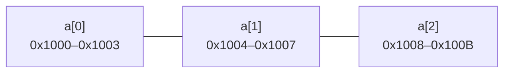
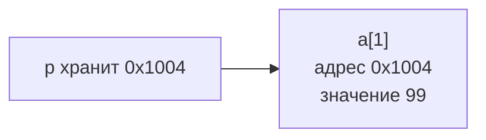

# Переменные, типы и память

[Оглавление](../README.md) · Язык C++

## Что такое переменная

Допустим, программа считает, сколько элементов она уже обработала. Ей нужно где-то сохранить счёт, чтобы прочитать его на следующем шаге. Для этого заводят **переменную**. Она позволяет хранить значение и обращаться к нему по имени.

```cpp
int count = 0;
count = count + 1;
```

В первой строке `count` — **имя**, `int` — **тип** (целое число), а `0` — **начальное значение**. Во второй строке программа читает прежнее значение `count`, прибавляет 1 и записывает результат обратно. Теперь в `count` хранится 1. Имя и тип остаются прежними.

Число `0` в коде задаёт начальное значение. Имя `count` позволяет вернуться к сохранённому значению позже. Место, где это значение хранится, в C++ называют **объектом**. Дальше разберём, что происходит при записи в объект и сколько места он занимает.

## Инициализация, присваивание и копирование

```cpp
int x = 7;     // У объекта x начальное значение 7.
int y = x;     // Отдельный объект y получает копию числа 7.
x = x + 1;     // В x записывается 8. В y остаётся 7.
int& ref = x;  // Ещё один способ обратиться к x.
ref = 9;       // В тот же объект x записывается 9.
```

| После строки | Значение `x` | Значение `y` |
|---|---:|---:|
| `int y = x;` | 7 | 7 |
| `x = x + 1;` | 8 | 7 |
| `ref = 9;` | 9 | 7 |

Инициализация задаёт начальное значение при создании объекта. Присваивание меняет значение существующего объекта. Например, в `x = x + 1` сначала вычисляется выражение справа, затем результат записывается в `x`. Обычное локальное объявление `int x;` не задаёт начального значения. В C++17 читать такое число до первой записи нельзя.

## Память по байтам

Память удобно представить как последовательность байтов. У каждого байта есть **адрес**. Если первый байт имеет адрес `0x1000`, следующий находится по адресу `0x1001`. Префикс `0x` означает шестнадцатеричную запись. В примерах ниже байт содержит 8 бит, как на большинстве современных платформ.

Объект обычно занимает несколько байтов. Например, на машине, где `int` имеет размер четыре байта, массив из трёх `int` занимает 12 байтов подряд. Пусть массив начинается по условному адресу `0x1000`:

| Элемент | Начальный адрес | Какие байты занимает |
|---|---|---|
| `a[0]` | `0x1000` | `0x1000`–`0x1003` |
| `a[1]` | `0x1004` | `0x1004`–`0x1007` |
| `a[2]` | `0x1008` | `0x1008`–`0x100B` |



Схема показывает именно **массив**. Его элементы лежат подряд по правилам C++. Две отдельно объявленные переменные так рисовать нельзя: язык не задаёт расстояние между ними или порядок их размещения. На обычной ОС адрес, который видит программа, относится к её виртуальной памяти. По нему нельзя определить, где находится байт на физической планке ОЗУ.

## Значение и его представление

Один и тот же набор байтов можно прочитать по-разному в зависимости от типа. Тип определяет диапазон значений и то, как интерпретировать записанные биты. Например, рассмотрим целое без знака шириной 32 бита со значением `0x12345678`. На машине с порядком байтов от младшего к старшему (*little-endian*) оно лежит в памяти так:

| Адрес | `0x1000` | `0x1001` | `0x1002` | `0x1003` |
|---|---|---|---|---|
| Байт в hex | `78` | `56` | `34` | `12` |

Адрес объекта — адрес его первого байта. В данном случае это `0x1000`. На машине с обратным порядком байтов по тому же адресу лежал бы байт `12`. Само числовое значение при этом осталось бы `0x12345678`.

`sizeof(T)` показывает, сколько байтов занимает объект типа `T`. В C++ `sizeof(char)` всегда равно 1, а размер `int` зависит от платформы. Число битов в байте можно проверить через `CHAR_BIT` из `<climits>`.

## Что лежит в указателе

Возьмём массив из первой схемы:

```cpp
int a[3] = {10, 20, 30};
int* p = &a[0];  // Объект p хранит адрес первого элемента.
p = &a[1];       // Изменился сам p. Массив остался прежним.
*p = 99;         // В выбранный элемент a[1] записано 99.
```

`p` — отдельный объект со своим адресом. Его **значение** здесь равно адресу элемента массива. Выражение `*p` обозначает сам выбранный элемент, поэтому запись через `*p` меняет массив. Если использовать условные адреса из схемы, после последней строки картина такая:



В строке `p = &a[1];` переписали адрес в указателе. В строке `*p = 99;` пошли по уже записанному адресу и изменили значение элемента. Это две разные записи в память.

## Стек, динамическая память и время жизни

На обычной платформе вызовы функций используют **стек**. У вызова может быть своя область для локальных данных и служебной информации. При возврате из функции этот кадр стека больше не нужен. Оптимизатор вправе хранить отдельные значения в регистрах или убрать их размещение целиком. Для кода C++ важно правило времени жизни: обычный локальный объект уничтожается при выходе из своего блока.

**Динамическое хранилище** часто называют кучей. Здесь программа может получить память нужного размера во время выполнения. Например:

```cpp
#include <vector>

void example() {
    std::vector<int> values(1000, 0);
    values[0] = 7;
}
```

`values` — локальный объект. Он управляет отдельной областью, где лежат 1000 элементов. При выходе из функции вектор уничтожается и освобождает эту область. Поэтому `sizeof(values)` показывает размер объекта вектора, а размер занятой его элементами области нужно считать отдельно.


У локального объекта с `static` имя видно только внутри своего блока, а сам объект может сохранять значение между вызовами. **Область видимости** отвечает на вопрос «где доступно имя», а **время жизни** — «когда объект существует». Если объект уже уничтожен, сохранившийся указатель на него становится висячим. Разыменовывать его нельзя.

## Выбор типа

| Нужно хранить | Подходящий тип | Пример |
|---|---|---|
| Целое число | `int` | `int count = 7;` |
| Большое целое или сумму | `long long` | `long long count = 3'000'000'000LL;` |
| Число с дробной частью | `double` | `double weight = 1.25;` |
| Логическое значение | `bool` | `bool found = false;` |
| Один символ из базового набора | `char` | `char letter = 'A';` |
| Строку | `std::string` | `std::string text = "abc";` |

Тип должен вмещать и промежуточные значения. Например, на платформе с 32-битным `int` произведение `100'000 * 100'000` уже не помещается в `int`. В записи `100'000LL * 100'000` первый операнд имеет тип `long long`, поэтому умножение выполняется в более широком типе и даёт 10 000 000 000.

## Что почитать дальше

- [Stanford CS106L, Introduction to Pointers (2008)](https://web.stanford.edu/class/archive/cs/cs106b/cs106b.1084/cs106l/handouts/050_Pointers.pdf) — адреса и разыменование.
- [Бьёрн Страуструп, A Tour of C++, 2-е издание (2018)](https://www.stroustrup.com/tour2.html) — типы, указатели, массивы и ссылки.

---

[→ Функции, ссылки и указатели](functions-and-pointers.md)
