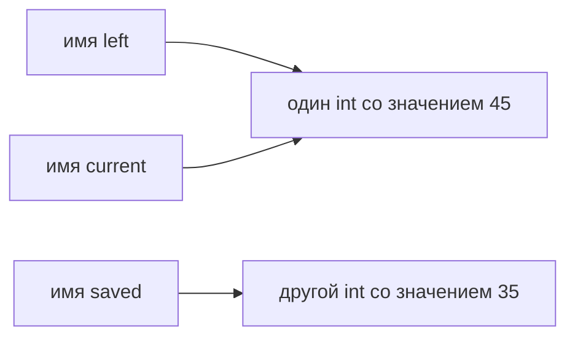
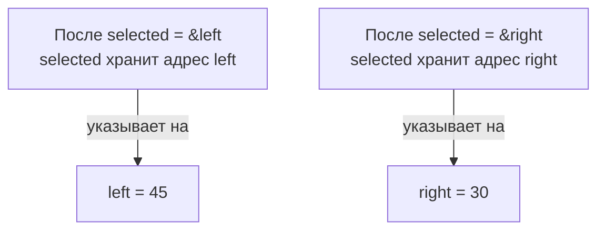
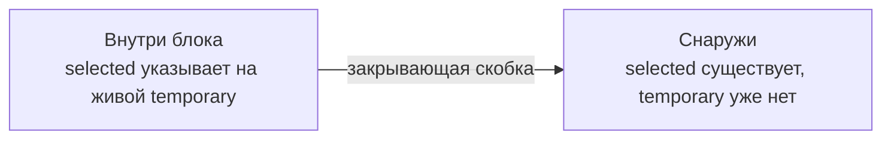

# Переменные, типы и память

[Оглавление](../README.md) · Язык C++

У робота есть две настройки мощности — для левого и правого мотора. Пока это просто два числа в программе. Начнём с левого мотора и проследим, что происходит с числом в каждой строке.

## Создать переменную и изменить её

```cpp
int left = 30;
left = left + 5;
int saved = left;
left = 50;
```

В первой строке создаётся объект типа `int` с именем `left` и значением 30. Это **инициализация**. Во второй строке объект уже существует. Чтобы выполнить `left = left + 5`, сначала прочитай старое значение справа, прибавь 5 и запиши результат в `left`. Это **присваивание**.

Попробуй предсказать, что останется в `saved` после последней строки. Вот как меняются оба объекта:

| После строки | `left` | `saved` |
|---|---:|---:|
| `int left = 30;` | 30 | ещё нет |
| `left = left + 5;` | 35 | ещё нет |
| `int saved = left;` | 35 | 35 |
| `left = 50;` | 50 | **35** |

В третьей строке `saved` получает число 35 и хранит его отдельно. Последняя строка меняет только `left`. Так можно сохранить прежнюю настройку, чтобы восстановить её позже.

Объявления вроде `int left;` внутри функции не задают начальное значение. В C++17 читать такое локальное число до первой записи нельзя. Если начальное значение известно, укажи его в объявлении: `int left = 0;`.

## Ссылка даёт второе имя

Иногда настройку нужно сохранить, а иногда — дать ей ещё одно имя. Продолжим пример с `left == 50` и `saved == 35`:

```cpp
int& current = left;
current = 45;
```

В объявлении `int& current` знак `&` означает, что `current` — **ссылка**. Оба имени, `left` и `current`, относятся к одному объекту. Поэтому после `current = 45;` значение `left` равно 45. Значение `saved` всё ещё 35.



Ссылка остаётся связана с исходным объектом. Например, `current = saved;` записало бы 35 в `left`. Для выбора между двумя объектами пригодится указатель.

## Указатель можно перенаправить

Добавим настройку второго мотора и переменную `selected`, в которой будем хранить адрес выбранной настройки:

```cpp
int right = 30;
int* selected = &left;

*selected = 60;      // Меняется left.
selected = &right;   // Выбираем другой объект. Мощности не меняются.
*selected = 70;      // Теперь меняется right.
```

В объявлении `int* selected` звёздочка входит в запись типа «указатель на `int`». В выражении `*selected` она означает «обратись к объекту по этому адресу». Знак `&` в выражении `&right` даёт адрес `right`.



Схема показывает цель указателя сразу после записи каждого адреса. Между этими моментами строка `*selected = 60;` меняет мощность левого мотора. В конце фрагмента `left == 60`, `right == 70`, а `saved == 35`.

Если пока ни одна настройка не выбрана, можно записать `int* selected = nullptr;`. Это явное отсутствие цели. Разыменовывать указатель можно только тогда, когда он указывает на подходящий живой объект.

## Когда объект перестаёт существовать

Рассмотрим отдельный пример. Внутри блока появляется локальная переменная `temporary`:

```cpp
int* selected = nullptr;
{
    int temporary = 25;
    selected = &temporary; // Внутри блока *selected можно прочитать.
}
// temporary уже уничтожена. *selected здесь использовать нельзя.
```

Указатель объявлен снаружи и продолжает существовать после закрывающей скобки. Объект `temporary` объявлен внутри и к этому моменту уже уничтожен. Указатель автоматически не становится `nullptr`. Такой указатель называют **висячим**. Проверки `selected != nullptr` недостаточно, чтобы узнать, жив ли объект.



**Область видимости** отвечает на вопрос, где в коде видно имя. **Время жизни** — когда существует сам объект. У обычной локальной переменной, как у `temporary`, конец жизни совпадает с выходом из блока. У локальной переменной с `static` имя по-прежнему видно только в своём блоке, но объект сохраняется между вызовами функции.

## Типы, размер и размещение в памяти

| Если нужно хранить | Начни с | Пример |
|---|---|---|
| Целое число | `int` | `int power = 30;` |
| Большое целое или сумму многих чисел | `long long` | `long long ticks = 3'000'000'000LL;` |
| Значение с дробной частью | `double` | `double voltage = 7.4;` |
| Ответ «да» или «нет» | `bool` | `bool ready = false;` |
| Символ команды | `char` | `char command = 'L';` |
| Строку | `std::string` | `std::string name = "Robot";` |

`const int max_power = 100;` обозначает значение, которое нельзя менять через это имя. С `auto power = 30;` компилятор сам выводит тип `int`. После объявления тип уже определён.

Подбирай тип и для промежуточного результата. На платформе с 32-битным `int` выражение `100'000 * 100'000` не помещается в `int`. Запись `100'000LL * 100'000` выполняет умножение в `long long` и даёт 10 000 000 000.

`sizeof` показывает размер в байтах. `sizeof(char)` всегда равно 1, а `sizeof(int)` зависит от платформы. Если один `int` занимает 4 байта, под миллион элементов нужно около 4 МБ. Для `std::vector<int> values(1'000'000);` выражение `sizeof(values)` показывает размер самого вектора. Память под его элементы выделена отдельно, и вектор освобождает её при уничтожении.

На практике обычные локальные объекты часто размещают **на стеке**, а динамическую память под элементы вектора выделяют **в куче**. Конкретное размещение зависит от реализации. Если разбираешь ошибку, полезнее сначала выяснить, создан ли объект, кто отвечает за его память и когда объект исчезнет.

## Что почитать дальше

- [Stanford CS106L, Introduction to Pointers (2008)](https://web.stanford.edu/class/archive/cs/cs106b/cs106b.1084/cs106l/handouts/050_Pointers.pdf) — короткая раздатка по адресам и разыменованию с задачами на чтение кода.
- [Бьёрн Страуструп, A Tour of C++, 2-е издание (2018)](https://www.stroustrup.com/tour2.html) — компактное изложение основ C++17 для тех, кто уже программировал.

---

[→ Функции, ссылки и указатели](functions-and-pointers.md)
