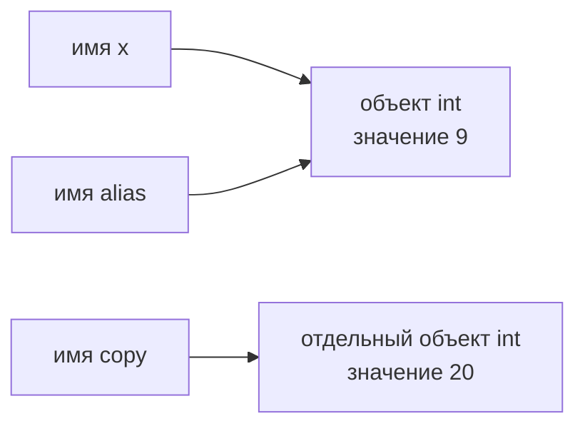
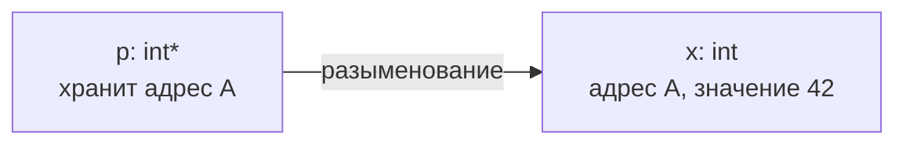

# Переменные, типы и память

[Оглавление](../README.md) · Язык C++

Когда пишешь `int x = 7;`, у тебя есть **имя** `x`, **тип** `int` и **текущее значение** 7. Тип определяет, какие значения можно хранить и какие операции с ними доступны. На схемах ниже коробка обозначает объект, а подпись на ней показывает его имя и значение. Это модель поведения программы. Компилятор может хранить значение в регистре или убрать отдельное место хранения, если результат программы от этого не изменится.

## Инициализация и присваивание

```cpp
int x = 7;  // Создаём переменную с начальным значением 7.
x = x + 1;  // Сначала считаем 7 + 1, затем записываем 8 в x.
```

Инициализация даёт объекту начальное значение. Присваивание меняет значение уже существующего объекта. Знак `=` здесь выполняет действие. Для сравнения в условии пишут `x == 8`.


Локальному числу лучше задавать начальное значение сразу. В C++17 запись `int total;` внутри обычной функции оставляет значение неопределённым. Читать его до первой записи нельзя. Начни с `int total = 0;`, если собираешь сумму.

## Как выбрать тип

| Тип | Что хранит | Пример |
|---|---|---|
| `bool` | Логическое значение | `bool ready = false;` |
| `char` | Один элемент символьных данных | `char command = 'L';` |
| `int` | Целое число | `int steps = 25;` |
| `long long` | Целое число размер которого не меньше 64 бит | `long long distance = 3'000'000'000LL;` |
| `double` | Число с плавающей точкой | `double speed = 1.25;` |
| `std::string` | Строку | `std::string name = "Robot";` |

`const int limit = 100;` запрещает присваивать новое значение переменной `limit`. `auto` просит компилятор вывести тип по начальному значению. Например, `auto size = 12;` даёт `int`, а `auto speed = 1.25;` даёт `double`. После объявления тип уже определён.

Выбирай тип по диапазону **всех промежуточных вычислений**. В примере ниже `1LL` имеет тип `long long`, поэтому уже первое умножение выполняется в широком типе.

```cpp
int width = 100'000;
int height = 100'000;
long long area = 1LL * width * height;  // 10 000 000 000
```

Если написать `long long area = width * height;`, умножение сначала выполнится в `int`. На платформе с 32-битным `int` результат переполнит этот тип ещё до присваивания.

## Байты и размер объекта

В большинстве используемых на практике систем байт содержит 8 бит. В C++ число битов в байте можно узнать через `CHAR_BIT` из `<climits>`. `sizeof` сообщает размер объекта или типа **в байтах**. Например, `sizeof(char)` всегда равен 1, а точный размер `int` зависит от реализации.

Для оценки памяти большого массива умножь число элементов на размер одного элемента. Например, при размере `int` в 4 байта миллион таких чисел занимает около 4 МБ только под элементы. Объекты вроде `std::vector` могут хранить данные в отдельной области. `sizeof(v)` даёт размер самого объекта вектора, без выделенной им памяти под элементы.

## Копия и ссылка

```cpp
int x = 7;
int copy = x;   // Новый объект с копией значения 7.
int& alias = x; // Второе имя того же объекта.

copy = 20;      // Теперь copy == 20, а x == 7.
alias = 9;      // Теперь x == 9, а copy == 20.
```



В C++ запись `int copy = x;` создаёт отдельный объект. Запись `int& alias = x;` даёт ещё один способ обратиться к `x`. На схеме две стрелки к одному объекту обозначают два имени.

## Адрес и указатель

```cpp
int x = 7;
int* p = &x;  // В p записан адрес x.
*p = 42;      // Записываем 42 в объект по адресу из p.
```



`&x` получает адрес объекта `x`. `*p` обращается к объекту по адресу, который хранится в `p`. После строки `*p = 42;` значение `x` стало 42, а сам адрес в `p` остался прежним. Буква A на схеме обозначает условный адрес.

## Видимость имени и время жизни

Область видимости показывает, где в коде можно обратиться к имени. Время жизни показывает, когда существует объект. У обычного локального `int` из примера обе границы понятны по фигурным скобкам.

```cpp
{
    int steps = 3;
    // Здесь имя steps видно, объект существует.
}
// Имя steps здесь уже недоступно, объект прекратил существование.
```

Указатель может пережить объект, на который указывал. После выхода из блока разыменовывать такой указатель нельзя. У локальной переменной с `static` другая ситуация. Имя видно внутри блока, а объект продолжает существовать между вызовами функции.

В разговорах о памяти часто встречаются **стек** и **куча**. В типичной реализации обычные локальные объекты могут размещаться на стеке. Динамическую память под элементы растущего вектора обычно выделяют из кучи. Например, локальный `std::vector<int> values(1000);` сам владеет памятью под элементы и освобождает её при уничтожении. Для понимания кода в первую очередь выясняй, **кто владеет объектом и когда он перестанет существовать**. Язык определяет эти правила независимо от того, как конкретный компилятор разместит данные.

Дальше эта модель понадобится, чтобы понять, меняет ли функция исходный аргумент. [Функции, ссылки и указатели](functions-and-pointers.md).

Подробнее о длительности хранения можно прочитать в [рабочем тексте стандарта C++](https://eel.is/c++draft/basic.stc).

---

[→ Функции, ссылки и указатели](functions-and-pointers.md)
