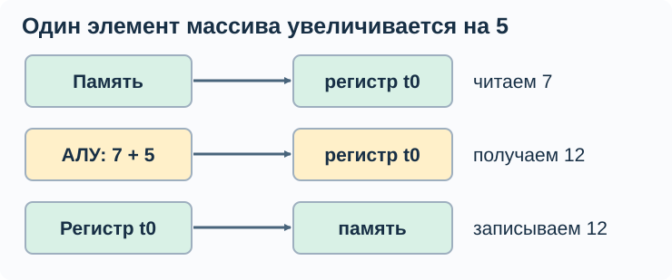

# Что делает процессор с одной строкой C++

[Читать на сайте с интерактивами](https://yaroslav-yarik.github.io/cpm-robotics-programming/hardware/cpu.html).

[Справочник](../README.md) · Устройство компьютера

```cpp
void add_five(int& value) {
    value = value + 5;
}
```

Допустим, в элементе массива лежит 7 и мы передали этот элемент в `add_five`. После вызова там должно быть 12. Как процессор доберётся до семёрки, если в исходнике написано только имя `value`?

## Адрес, регистр и команда

Компилятор переводит операции C++ в **машинные инструкции** выбранного процессора. Возьмём для разбора RISC-V на платформе, где C++ использует 32-битный тип `int`. Пусть адрес элемента уже передан в регистре `a0`. **Регистр** — маленькое хранилище внутри ядра, которое инструкция может назвать прямо. Другой регистр, `t0`, используем как временный. Ниже один возможный фрагмент тела функции в записи на ассемблере.

```asm
lw   t0, 0(a0)
addi t0, t0, 5
sw   t0, 0(a0)
```



<!-- interactive -->

| Инструкция | Что она делает | Что стало с числом |
|---|---|---|
| `lw` — load word | Читает четыре байта по адресу из `a0` со смещением ноль | В `t0` теперь 7 |
| `addi` — add immediate | Передаёт значение регистра и число 5 в арифметико-логическое устройство (АЛУ) | В `t0` теперь 12. По адресу пока лежит 7 |
| `sw` — store word | Записывает четыре байта из `t0` по тому же адресу | Следующее чтение этого элемента программой даст 12 |

Ноль в `0(a0)` — отступ от адреса. После всех трёх инструкций `a0` всё ещё указывает на тот же элемент. Получить данные процессор может из [кэша](memory.md), поэтому отдельная загрузка не обязательно означает обращение к микросхеме оперативной памяти.

## Откуда процессор узнаёт, что делать дальше?

Машинная инструкция — набор битов. Часть битов обозначает операцию, другие поля задают регистры или число. **Счётчик команд** хранит адрес инструкции. Процессор выбирает команду по адресу, распознаёт её поля и выполняет действие. В обычной последовательности управление переходит к следующей инструкции. Условный переход может заменить следующий адрес другим. Так можно вернуться к началу цикла, если остались элементы.

Один такт — один период тактового сигнала. У разных команд бывают разные задержки. В современном ядре несколько инструкций могут одновременно находиться на разных стадиях обработки. Поэтому число строк C++ и даже число машинных инструкций сами по себе не дают времени выполнения.

## Всегда ли возникнут эти три инструкции?

C++ задаёт наблюдаемый результат. Компилятор может встроить функцию в место вызова, удержать промежуточное значение в регистре или заранее вычислить константу. Если позже результат вообще не используется, вычисление иногда исчезает целиком. Для Python путь тоже проходит через процессор. Например, в CPython операции программы выполняет интерпретатор, и сложение двух объектов Python требует иной последовательности машинных инструкций.

В лабораторной Berkeley можно увидеть похожий цикл: чтение слова, прибавление единицы, запись и переход к новому адресу. [CS61C, осень 2020, cache.s](https://github.com/61c-teach/fa20-lab-starter/blob/e4545d88812dcc2c618f0b194f5acc2b6681b9e2/lab07/cache.s).
