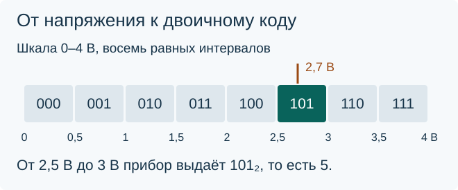

# Ввод и вывод: от напряжения до числа

[Читать на сайте с интерактивами](https://yaroslav-yarik.github.io/cpm-robotics-programming/hardware/io.html).

[Справочник](../README.md) › Устройство компьютера

Аналоговый датчик освещённости выдаёт напряжение, которое меняется вместе с освещённостью. Программе для сравнения с порогом нужно число. Посмотрим, где это число появляется, как оно попадает в переменную и что можно узнать по последовательности таких чисел.

## Сколько значений различит АЦП?

**Аналого-цифровой преобразователь (АЦП)** измеряет напряжение и выдаёт целый код. Возьмём простой учебный АЦП с диапазоном от 0 до 4 В и трёхбитным результатом. Из трёх битов можно составить восемь кодов, от `000` до `111`. В нашей модели каждому коду соответствует интервал шириной 4 / 8 = 0,5 В. Нижняя граница входит в интервал, верхняя открывает следующий. Верхнему пределу 4 В соответствует последний код.



<!-- interactive -->

При 2,6 В получим 5. При 2,7 В снова получим 5. По сохранённой пятёрке можно назвать **интервал** исходных напряжений. Чтобы различать более близкие значения при том же диапазоне, потребуется более мелкий шаг. Например, десять битов дают 1024 кода. На точность реального измерения также влияют погрешность прибора, шум и опорное напряжение.

## Как число попадает в программу?

В микроконтроллере AVR преобразователь работает как отдельный узел. Библиотека выбирает канал, даёт команду начать преобразование и ждёт готовности. Готовый результат можно прочитать из **регистров периферии**. Так называют ячейки, через которые процессор обменивается данными и командами с устройством. Например, на ATmega328P десять битов результата считываются частями из двух восьмибитных регистров. Библиотека собирает из них одно число. [Реализация analogRead для AVR](https://github.com/arduino/ArduinoCore-avr/blob/1.8.3/cores/arduino/wiring_analog.c)

```cpp
// На Arduino с десятибитным АЦП результат лежит в диапазоне 0…1023.
int sample = analogRead(A0);
bool upper_half = sample >= 512;
```

Первая строка получает один отсчёт со входа A0. Вторая проверяет, попал ли код в верхнюю половину шкалы. Если напряжение изменится через мгновение, в `sample` останется старое число. Для нового отсчёта надо снова прочитать вход. Встроенный пример Arduino показывает, как вывести считанное значение после пересчёта в вольты. [ReadAnalogVoltage](https://github.com/arduino/Arduino/blob/1.8.13/build/shared/examples/01.Basics/ReadAnalogVoltage/ReadAnalogVoltage.ino)

## Что пропускается между отсчётами?

Пусть программа читает вход в моменты 0, 10 и 20 мс. Если короткий импульс начался на 3-й мс и закончился на 7-й, во всех трёх отсчётах будет исходный уровень. Разрядность определяет, насколько мелкие изменения **по уровню** различает АЦП. Интервал между чтениями определяет, насколько часто мы видим сигнал **во времени**. Именно последовательность сохранённых отсчётов получает алгоритм поиска серий. [Как обрабатывать сигнал](../robotics/signals.md)

## Как вывести данные на экран?

Обратный путь тоже начинается с числа. В примере одно число от 0 до 255 задаёт яркость одного пикселя. Считаем строки, столбцы и байты с нуля. Пусть в строке четыре пикселя, каждый занимает один байт, а строки записаны подряд без промежутков. Тогда запись в байт с номером 6 изменит яркость пикселя во второй строке и третьем столбце.

**Кадровый буфер** хранит значения пикселей кадра. Когда контроллер дисплея считывает буфер для вывода, обновлённый байт задаёт яркость соответствующей точки. На экране с другим форматом пикселей или с дополнительными байтами в конце строки формула адреса меняется. [Схема адреса пикселя](../robotics/grids-and-images.md)

[← Как устроена память компьютера](memory.md) · [Как процессор выполняет команды](cpu.md)
