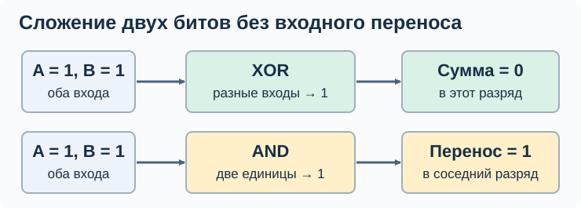

# Как из двух битов получается сумма

[Справочник](../README.md) · Устройство компьютера

Когда мы пишем `1 + 1`, ответ занимает уже два двоичных разряда: `10₂`. Разберём, как схема с двумя входами выдаёт эти два бита.

## Как провод передаёт ноль или единицу

Внутри микросхемы информация передаётся электрическими сигналами. Один диапазон напряжений схема распознаёт как 0, другой — как 1. Точные границы зависят от технологии. Транзистор позволяет одним электрическим сигналом управлять током. Из транзисторов собирают **логические элементы**. Например, на выходе элемента AND появляется единица, только когда оба входа равны единице.

## Как сложить один разряд

У схемы сложения два выхода. На одном нужен бит суммы в текущем разряде, на втором — перенос в следующий. Выпишем все четыре случая. В строке с двумя единицами ответ читается как «один перенос и ноль в текущем разряде».

| A | B | Бит суммы | Перенос |
|---:|---:|---:|---:|
| 0 | 0 | 0 | 0 |
| 0 | 1 | 1 | 0 |
| 1 | 0 | 1 | 0 |
| 1 | 1 | 0 | 1 |

Столбец суммы совпадает с результатом XOR («входы различаются»), столбец переноса — с AND («обе единицы»). Подадим два сигнала сразу на оба элемента. Такая схема называется **полусумматором**.

У старшего разряда бывает ещё один вход — перенос от правого соседа. Схема, которая складывает все три бита, называется **полным сумматором**. Например, при сложении `0111₂ + 0001₂` перенос проходит через три младших разряда и результатом становится `1000₂`. В процессорах используют и схемы, которые вычисляют переносы сразу для групп разрядов.

## Почему результат можно сохранить

Выход логического элемента меняется вслед за входами с небольшой задержкой. Чтобы результат дождался следующей операции, нужны элементы **памяти**. Например, D-триггер захватывает один бит по активному фронту тактового сигнала и удерживает его до следующего такого фронта. Несколько таких элементов с общим тактом могут образовать регистр. В простейшем четырёхбитном регистре четыре отдельных элемента одновременно сохранят `1000`.

Здесь соединяются три темы справочника: [побитовые операции](../cpp/bits-and-bitset.md) описывают преобразования отдельных разрядов, [процессор](cpu.md) выбирает операцию, а [память](memory.md) сохраняет данные между обращениями.

Курс Нисана и Шокена предлагает собрать полусумматор, полный сумматор и затем арифметико-логическое устройство. [Nand to Tetris, Boolean Arithmetic](https://www.nand2tetris.org/project02).
