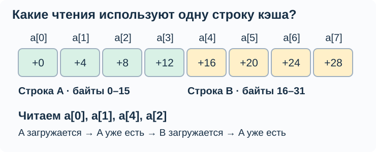
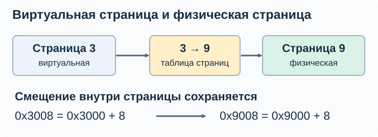

# Где находится число, когда его читает процессор?

[Справочник](../README.md) · Устройство компьютера

Пусть программа суммирует элементы массива. В C++ каждый шаг можно записать как `sum += a[i]`. У процессора при этом две разные задачи: найти нужные байты по адресу и получить их достаточно быстро.

## Почему соседнее число часто уже рядом

**Кэш** держит близко к ядру копии недавно затребованных данных. Обмен между уровнями памяти обычно идёт блоками, которые называют **строками кэша**. Если нужные байты уже находятся на проверяемом уровне, происходит *попадание*. При *промахе* приходится запросить данные дальше по иерархии. На обычном компьютере таких уровней несколько.

Для рисунка возьмём упрощённую машину. Целое занимает 4 байта, строка кэша — 16 байтов, начало массива совпадает с началом строки. В пустом кэше есть место для обеих показанных строк без взаимного вытеснения. Опережающую загрузку отключим. Числа под индексами — смещения в байтах от начала массива.

При первом чтении `a[0]` подгружаются байты 0–15. Следующий элемент `a[1]` уже там. Для `a[4]` потребуется вторая строка, а для `a[2]` по-прежнему доступна первая. Итого четыре чтения программы, два промаха в нашей модели. На конкретном процессоре результат зависит от размеров и устройства кэша, выравнивания, предвыборки и остальных обращений.

При последовательном обходе мы скоро используем соседей каждого элемента. Это **пространственная локальность**. Если мы вскоре снова обращаемся к тем же данным, это **временная локальность**. Оба эффекта помогают понять, почему два обхода с одинаковой сложностью `O(n)` иногда занимают разное время.

## Где память физически хранит биты

В ядре процессора регистры дают командам быстрый доступ к небольшому числу значений. Для кэшей обычно используют **SRAM**. Её ячейка поддерживает одно из двух устойчивых состояний, пока подаётся питание. Для основной оперативной памяти ПК обычно используют **DRAM**. В типичной ячейке DRAM бит представлен зарядом маленького конденсатора, а транзистор открывает доступ к нему. Заряд постепенно утекает, поэтому содержимое периодически обновляется. Такие ячейки компактны, и их можно разместить очень много.

Жёсткий диск или SSD сохраняет файлы и после выключения питания. При обычном чтении файла операционная система делает данные доступными программе через оперативную память. На SSD байты файла привязаны к устройству хранения, а указатель C++ обозначает адрес в пространстве работающей программы.

## Как адрес программы связан с оперативной памятью

На компьютере с виртуальной памятью операционная система делит адресное пространство процесса на **страницы**. Для страниц, находящихся в оперативной памяти, она задаёт сопоставление с физическими страницами и права доступа. Аппаратура процессора использует эти сведения при обращении к памяти. Часто используемые переводы адресов тоже кэшируются.

Пусть размер страницы равен 4096 байтам, то есть `0x1000`. Адрес `0x3008` лежит на виртуальной странице 3, на восемь байтов дальше её начала. Если система сопоставила её физической странице 9, искомый байт имеет физический адрес `0x9008`. Другой процесс может получить другое сопоставление для такого же виртуального адреса. На микроконтроллере без механизма виртуальной памяти эта стадия перевода может отсутствовать.

**Связанные главы.** [Как устроена память в примерах на C++](../cpp/memory-layout.md) · [Массивы и векторы](../cpp/arrays-and-vectors.md) · [Префиксные суммы](../algorithms/prefix-sums.md).

Подробнее о порядке обращений — в [Algorithmica, Spatial and Temporal Locality, версия 2021 года](https://github.com/algorithmica-org/algorithmica/blob/3de178bbf42fc4bb58748f19abd1822cddeb4fe3/content/english/hpc/memory/locality.md). Перевод адресов на примере учебной ОС разобран в [MIT xv6, Page tables, версия 2021 года](https://github.com/mit-pdos/xv6-riscv-book/blob/57be33eeb73930a1d290203fd32ba9ebf307e27c/mem.tex).
