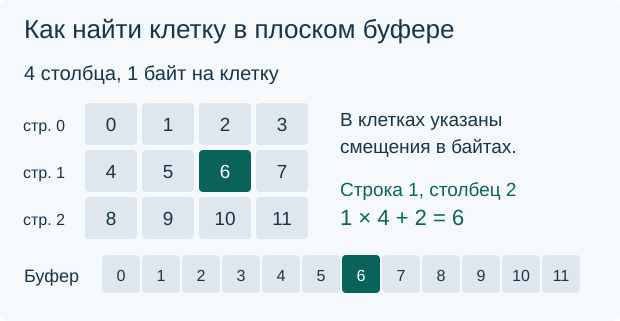

# Клеточные карты и изображения

[Читать на сайте с интерактивами](https://yaroslav-yarik.github.io/cpm-robotics-programming/robotics/grids-and-images.html).

[Оглавление](../README.md) · Прикладные алгоритмы

Клетку карты задаёт пара `(строка, столбец)`. Эти же координаты используются для пикселей изображения. Нумерацию начинаем с нуля.

## Как координаты превращаются в адрес пикселя

Пусть в изображении в оттенках серого три строки по четыре пикселя. Каждый пиксель хранит яркость в одном байте. Если строки плоского буфера идут подряд без выравнивающих промежутков, смещение пикселя равно `row * width + col` байтам. Перед клеткой `(1, 2)` лежит целая первая строка и два байта второй. Значит, её смещение равно `1 * 4 + 2 = 6`.



<!-- interactive -->

Так можно хранить данные для контроллера дисплея. В примерах ниже встречается и `vector<vector<...>>`. У каждой строки такого вектора собственная область памяти. Чтобы добраться до клетки, сначала выбираем строку, затем элемент этой строки. [Как кадр попадает на экран](../hardware/io.md)

## Как направление меняет координаты

Строки считаются сверху вниз, столбцы слева направо. При одном шаге меняется только одна координата.

| Номер | Направление | Прибавить к строке | Прибавить к столбцу |
|---|---|---|---|
| 0 | ↑ север | −1 | 0 |
| 1 | → восток | 0 | +1 |
| 2 | ↓ юг | +1 | 0 |
| 3 | ← запад | 0 | −1 |

Координаты и направление вместе образуют **позу**. При повороте направо новый номер направления равен `(direction + 1) % 4`. При движении прямо умножаем сдвиг из таблицы на число шагов. Например, два шага на север из `(3, 2)` ведут через `(2, 2)` в `(1, 2)`.

**C++**

```cpp
#include <utility>

using std::pair;

pair<long long, long long> move(long long row, long long col,
                                int direction, long long steps) {
    const int row_offsets[] = {-1, 0, 1, 0};
    const int col_offsets[] = {0, 1, 0, -1};
    return {row + steps * row_offsets[direction], col + steps * col_offsets[direction]};
}
```

<details>
<summary>Тот же алгоритм на Python</summary>

```python
def move(row, col, direction, steps):
    offsets = [(-1, 0), (0, 1), (1, 0), (0, -1)]
    row_offset, col_offset = offsets[direction]
    return row + steps * row_offset, col + steps * col_offset
```

</details>

Формула описывает движение по свободной плоскости. Номер направления должен быть от 0 до 3, число шагов — неотрицательным, а результат вычислений в C++ должен помещаться в `long long`. Если есть стены, проверь допустимость каждой промежуточной позиции или вычисли расстояние до препятствия перед решением о перемещении.

## Рамка группы клеток

После [обхода карты](../algorithms/grid-traversal.md) известны клетки одной связной области. Возьмём три клетки `(1, 1)`, `(1, 2)` и `(2, 1)`. На схеме они отмечены `×`.

```text
             столбец 1   столбец 2
строка 1         ×           ×
строка 2         ×           ·
```

Самая верхняя строка области — `1`, самая нижняя — `2`. По столбцам границы тоже `1` и `2`. Чтобы найти такую рамку у любой непустой области, начинаем с первой клетки и расширяем границы после чтения каждой следующей.

**C++**

```cpp
#include <algorithm>
#include <array>
#include <utility>
#include <vector>

using std::array;
using std::max;
using std::min;
using std::pair;
using std::vector;

array<int, 4> bounding_box(const vector<pair<int, int>>& cells) {
    int top = cells.front().first;
    int bottom = top;
    int left = cells.front().second;
    int right = left;
    for (auto [row, col] : cells) {
        top = min(top, row);
        bottom = max(bottom, row);
        left = min(left, col);
        right = max(right, col);
    }
    return {top, left, bottom, right};
}
```

<details>
<summary>Тот же алгоритм на Python</summary>

```python
def bounding_box(cells):
    top = bottom = cells[0][0]
    left = right = cells[0][1]
    for row, col in cells:
        top = min(top, row)
        bottom = max(bottom, row)
        left = min(left, col)
        right = max(right, col)
    return top, left, bottom, right
```

</details>

Функция возвращает `(верх, лево, низ, право)`. Обе границы включены, поэтому площадь равна `(низ − верх + 1) · (право − лево + 1)`. На схеме площадь равна четырём, а заняты три клетки. Если список не содержит повторов, равенство площади рамки и числа клеток означает, что рамка заполнена целиком. Рамку можно обновлять прямо в ходе обхода компоненты, если потом не требуется хранить сами клетки.

## Как сохранить несколько признаков одной клетки

Состояние клетки может учитывать сразу несколько источников. Например, если один датчик обнаруживает синий цвет, а другой жёлтый, по одному биту на каждый цвет сохраняет оба свидетельства. Начнём с двоичной маски `00`. Синий цвет (бит 0) даёт `01`. После жёлтого (бит 1) получим `01 | 10 = 11`. Повторное наблюдение синего оставит `11 | 01 = 11`. Так [побитовое ИЛИ](../cpp/bits-and-bitset.md) сохраняет оба признака в любом порядке. Перед первым наблюдением все маски в `grid` равны нулю.

**C++**

```cpp
#include <cstdint>
#include <vector>

using std::uint32_t;
using std::vector;

void record_color(vector<vector<uint32_t>>& grid,
                  int row, int col, unsigned color) {
    grid[row][col] |= uint32_t{1} << color;
}
```

<details>
<summary>Тот же алгоритм на Python</summary>

```python
def record_color(grid, row, col, color):
    grid[row][col] |= 1 << color
```

</details>

Координаты должны быть допустимыми, номер цвета в C++ лежит в диапазоне от 0 до 31. Если клетки приходят от лучевого датчика, перечисли клетки вдоль известного луча и для каждой запиши соответствующее свидетельство. Что значит последний отсчёт и могут ли наблюдения противоречить друг другу, зависит от модели датчика. Приведённая функция хранит факт наблюдения. Когда нужно число наблюдений, требуются счётчики.

## Как совместить два набора точек

Поворот квадрата со стороной `side_length` на 90° по часовой стрелке переводит клетку `(row, col)` в `(col, side_length - 1 - row)`. Для совмещения двух наборов точек при фиксированном повороте сравни координаты. Если точка `(second_row, second_col)` второго набора должна перейти в `(first_row, first_col)` первого, возможен ровно один сдвиг `(first_row - second_row, first_col - second_col)`. Например, в первом наборе отмечены `(1, 2)` и `(1, 3)`, а во втором — `(0, 0)` и `(0, 1)`. Сдвиг `(1, 2)` совмещает обе пары точек. Со сдвигом `(1, 3)` точка `(0, 0)` попадает в `(1, 3)`, а `(0, 1)` — в `(1, 4)`, где совпадения уже нет.

Вместо наложения целых карт каждая пара точек отдаёт один «голос» за свой сдвиг. Если точки внутри каждого набора различны, число голосов равно числу совпадений. `rotate_point` поворачивает точку, а `shift_votes` считает голоса уже при выбранном повороте.

**C++**

```cpp
#include <map>
#include <utility>
#include <vector>

using std::map;
using std::pair;
using std::vector;

using Point = pair<int, int>;

Point rotate_point(int row, int col, int side_length) {
    return {col, side_length - 1 - row};
}

using Shift = pair<long long, long long>;

map<Shift, long long> shift_votes(const vector<Point>& first,
                                 const vector<Point>& second) {
    map<Shift, long long> votes;
    for (auto [first_row, first_col] : first) {
        for (auto [second_row, second_col] : second) {
            const long long row_shift = static_cast<long long>(first_row) - second_row;
            const long long col_shift = static_cast<long long>(first_col) - second_col;
            ++votes[{row_shift, col_shift}];
        }
    }
    return votes;
}
```

<details>
<summary>Тот же алгоритм на Python</summary>

```python
from collections import Counter

def rotate_point(row, col, side_length):
    return col, side_length - 1 - row

def shift_votes(first, second):
    votes = Counter()
    for first_row, first_col in first:
        for second_row, second_col in second:
            votes[first_row - second_row, first_col - second_col] += 1
    return votes
```

</details>

Оба фрагмента возвращают голоса для сдвигов с хотя бы одним совпадением. Если пустые маски или сдвиги с нулём совпадений важны, учти их отдельно. Метод перебирает `a · b` пар для наборов размеров `a` и `b`. Каждое добавление в `Counter` в среднем занимает постоянное время, а в `std::map` зависит логарифмически от числа разных сдвигов. Память пропорциональна числу разных сдвигов.

## Предвычисление расстояния до преграды

Если на прямоугольной карте много запросов «сколько свободных клеток подряд справа», можно заполнить таблицу одним проходом. Для свободной клетки ответ равен 1 плюс ответ её правого соседа, если сосед тоже свободен. Если справа стена или край, ответ 0. Поэтому обходи строку справа налево. В примере свободная клетка обозначена точкой, стена — решёткой.

**C++**

```cpp
#include <cstddef>
#include <string>
#include <vector>

using std::size_t;
using std::string;
using std::vector;

vector<vector<size_t>>
free_to_right(const vector<string>& grid) {
    vector<vector<size_t>> result;
    for (const auto& row : grid) {
        vector<size_t> distances(row.size(), 0);
        for (size_t next = row.size(); next > 1; --next) {
            const size_t col = next - 2;
            if (row[col] == '.' && row[col + 1] == '.') {
                distances[col] = 1 + distances[col + 1];
            }
        }
        result.push_back(distances);
    }
    return result;
}
```

<details>
<summary>Тот же алгоритм на Python</summary>

```python
def free_to_right(grid):
    result = []
    for row in grid:
        distances = [0] * len(row)
        for col in range(len(row) - 2, -1, -1):
            if row[col] == row[col + 1] == ".":
                distances[col] = 1 + distances[col + 1]
        result.append(distances)
    return result
```

</details>

Для строки `...#..` удобно проверить таблицу справа налево.

| Столбец | 0 | 1 | 2 | 3 | 4 | 5 |
|---|---|---|---|---|---|---|
| Клетка | `.` | `.` | `.` | `#` | `.` | `.` |
| Свободно справа | 2 | 1 | 0 | 0 | 1 | 0 |

Из столбца `1` можно сделать один шаг до стены. В столбце `3` стоит сама стена, поэтому храним служебный ноль. Для остальных направлений меняй ось и порядок обхода так, чтобы сосед был уже обработан. Предвычисление для карты `h × w` занимает `O(h · w)` времени и памяти, затем один запрос выполняется за `O(1)`.

Таблица пригодится и при сопоставлении показаний с картой, если показание датчика в модели равно числу свободных клеток до препятствия в выбранном направлении. Когда известна карта, а начальная поза неизвестна, перебери допустимые позы. Для каждой поддерживай текущую позу и сверяй предвычисленное показание в момент, когда по журналу был сделан замер. Первое несовпадение исключает начальную позу. Если хранишь найденные варианты, записывай начальную позу отдельно от текущей.

---

[← Обработка сигналов](signals.md)
