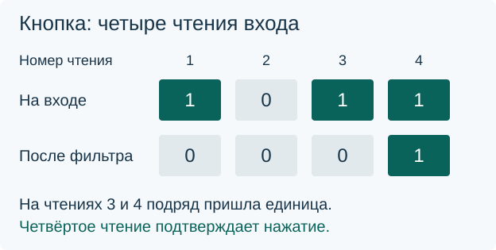

# Обработка сигналов

[Читать на сайте с интерактивами](https://yaroslav-yarik.github.io/cpm-robotics-programming/robotics/signals.html).

[Оглавление](../README.md) · Прикладные алгоритмы

Показания датчика образуют последовательность, например `4, 4, 9, 9, 4`. По такой записи можно найти участки постоянного уровня, отличить устойчивое изменение от короткого скачка или подсчитать значения выше выбранного порога.

## Где начинается и заканчивается серия

**Серия** — максимальный участок подряд идущих одинаковых значений. Здесь число `4` встречается в двух отдельных сериях.

| Индекс | 0 | 1 | 2 | 3 | 4 |
|---|---|---|---|---|---|
| Показание | 4 | 4 | 9 | 9 | 4 |
| Серия | A | A | B | B | C |

Серия B начинается в позиции `2` и заканчивается перед позицией `4`. Такую границу записывают как полуинтервал `[2, 4)`. Число отсчётов равно `4 − 2 = 2`.

Функция возвращает тройки `(начало, конец, значение)`. На этом примере получатся `(0, 2, 4)`, `(2, 4, 9)` и `(4, 5, 4)`.

Индекс `start` отмечает начало текущей серии. Как только значение изменилось, записываем готовую серию и переносим `start`. Последнюю серию записываем, когда `end` доходит до длины массива. Условие проверяет конец первым, и тогда `or` в Python и `||` в C++ пропускают чтение `values[end]`.

**C++**

```cpp
#include <cstddef>
#include <tuple>
#include <vector>

using std::size_t;
using std::tuple;
using std::vector;

using Run = tuple<size_t, size_t, int>;

vector<Run> runs(const vector<int>& values) {
    vector<Run> result;
    size_t start = 0;
    for (size_t end = 1; end <= values.size(); ++end) {
        if (end == values.size() || values[end] != values[start]) {
            result.emplace_back(start, end, values[start]);
            start = end;
        }
    }
    return result;
}
```

<details>
<summary>Тот же алгоритм на Python</summary>

```python
def runs(values):
    result = []
    start = 0
    for end in range(1, len(values) + 1):
        if end == len(values) or values[end] != values[start]:
            result.append((start, end, values[start]))
            start = end
    return result
```

</details>

**Если ищем импульс выше порога.** Для ряда `4, 8, 9, 4` и порога `6` сравнения `x > 6` дадут `ложь, истина, истина, ложь`. Так числа `8` и `9` попадут в один импульс `[1, 3)`. Если в задаче нужен фон с обеих сторон, проверь отдельно импульсы у краёв записи.

Соседство в кольце требует дополнительного шага. Если линейных серий больше одной и значения первой и последней совпадают, эти две серии на кольце образуют одну. Храни их как два исходных полуинтервала, если нужны реальные индексы. Обработка серий занимает `O(n)`.

## Подтверждение устойчивого сигнала

При дребезге механической кнопки короткие смены уровня пропускают, а новый уровень принимают после непрерывного интервала устойчивости. В дискретной модели ниже новый уровень подтверждается после `required_samples` одинаковых отсчётов подряд. Счётчик сбрасывается при каждой смене сырого уровня. Начальное подтверждённое состояние равно 0, а `required_samples > 0`.

**C++**

```cpp
#include <cstddef>
#include <vector>

using std::size_t;
using std::vector;

vector<int> stable_levels(const vector<int>& samples,
                               size_t required_samples) {
    int confirmed_level = 0;
    int candidate_level = 0;
    size_t streak_length = 0;
    vector<int> result;
    for (int value : samples) {
        if (value != candidate_level) {
            candidate_level = value;
            streak_length = 0;
        }
        ++streak_length;
        if (streak_length == required_samples) {
            confirmed_level = candidate_level;
        }
        result.push_back(confirmed_level);
    }
    return result;
}
```

<details>
<summary>Тот же алгоритм на Python</summary>

```python
def stable_levels(samples, required_samples):
    confirmed_level = candidate_level = 0
    streak_length = 0
    result = []
    for value in samples:
        if value != candidate_level:
            candidate_level, streak_length = value, 0
        streak_length += 1
        if streak_length == required_samples:
            confirmed_level = candidate_level
        result.append(confirmed_level)
    return result
```

</details>



<!-- interactive -->

При нажатии металлические контакты могут несколько раз разомкнуться и снова коснуться друг друга. Вход микроконтроллера при этом успевает прочитать разные уровни. На рисунке показаны именно моменты чтения. Между ними вход мог переключаться ещё раз. В примере Arduino момент последней смены уровня запоминают и принимают новое состояние после заданной задержки. [Пример Debounce, 2006–2016](https://github.com/arduino/Arduino/blob/1.8.13/build/shared/examples/02.Digital/Debounce/Debounce.ino) · [Откуда берутся отсчёты](../hardware/io.md)

При `required_samples = 2` одиночная единица пропадает после следующего чтения. Разберём четыре отсчёта с начальным подтверждённым уровнем `0`.

| Отсчёт | Кандидат | Длина серии | Подтверждённый уровень |
|---|---|---|---|
| `1` | 1 | 1 | 0 |
| `0` | 0 | 1 | 0 |
| `1` | 1 | 1 | 0 |
| `1` | 1 | 2 | 1 |

Каждый отсчёт обрабатывается один раз, поэтому время работы `O(n)`. Для отсчётов с неравными интервалами удобнее сравнивать отметки времени. Вместо длины серии храни момент появления кандидата и проверяй прошедшее время. При анализе записи учитывай последнюю известную отметку, чтобы не предполагать устойчивость за её пределами.

## Как перебрать существенные пороги

Для правила `x >= threshold` на целых числах состав выбранных элементов меняется только после перехода через наблюдаемое значение. Например, для значений 4 и 9 пороги 5, 6, 7, 8 и 9 выбирают один и тот же набор. Поэтому для поиска лучшего порога можно рассмотреть наблюдавшиеся значения и один порог выше максимума. Промежуточные пороги дают те же наборы.

Например, для отсортированного массива `[4, 4, 9]` достаточно трёх проверок.

| Порог | Какие элементы проходят | Сколько |
|---|---|---|
| `4` | `4, 4, 9` | 3 |
| `9` | `9` | 1 |
| `10` | ∅ | 0 |

Функции возвращают пары `(порог, количество)`. Сортируем вход. При встрече новой группы одинаковых значений все элементы от начала группы до конца массива проходят порог. Из этих сведений можно построить оценку по своему критерию. Предполагаем, что `max(values) + 1` помещается в знаковый 64-битный тип.

**C++**

```cpp
#include <algorithm>
#include <cstddef>
#include <utility>
#include <vector>

using std::pair;
using std::size_t;
using std::sort;
using std::vector;

vector<pair<long long, size_t>>
threshold_counts(vector<long long> ordered) {
    sort(ordered.begin(), ordered.end());
    vector<pair<long long, size_t>> result;
    for (size_t index = 0; index < ordered.size(); ++index) {
        if (index == 0 || ordered[index] != ordered[index - 1]) {
            result.emplace_back(ordered[index], ordered.size() - index);
        }
    }
    if (!ordered.empty()) {
        result.emplace_back(ordered.back() + 1, 0);
    }
    return result;
}
```

<details>
<summary>Тот же алгоритм на Python</summary>

```python
def threshold_counts(values):
    ordered = sorted(values)
    result = []
    for index, threshold in enumerate(ordered):
        if index == 0 or threshold != ordered[index - 1]:
            result.append((threshold, len(ordered) - index))
    if ordered:
        result.append((ordered[-1] + 1, 0))
    return result
```

</details>

Сортировка и проход требуют `O(n log n)` времени. Когда порог ограничен заданными границами или при совпадении оценок нужен конкретный порог, отдельно выясни, какой представитель допустим в каждом промежутке.

---

[← Состояние и события](state-and-events.md) · [→ Клеточные карты и изображения](grids-and-images.md)
