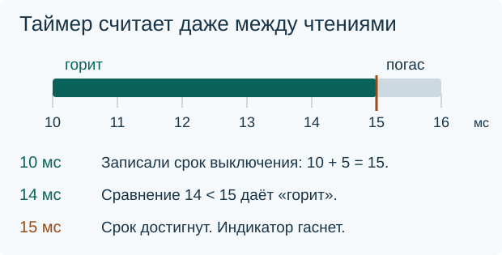

# Состояние и события

[Читать на сайте с интерактивами](https://yaroslav-yarik.github.io/cpm-robotics-programming/robotics/state-and-events.html).

[Оглавление](../README.md) · Прикладные алгоритмы

В журнале записаны команды «включить индикатор» и «прочитать индикатор». Чтобы ответить на очередное чтение, достаточно помнить, когда индикатор должен погаснуть. Эту часть истории, которую программа сохраняет для следующего шага, называют **состоянием**.

Вид состояния зависит от задачи. Для настроек подойдёт набор флагов, для счётчика понадобится предыдущее показание, а для таймера — время выключения.

## Флаги в одной маске

**Флаг** хранит ответ «да» или «нет». Пусть бит 0 отвечает за звук, бит 1 за вибрацию, бит 2 за подсветку. Биты считаем справа налево. В состоянии `0101` включены звук и подсветка.

| Что требуется | Маска | Результат `0101 & маска` | Всё включено? |
|---|---|---|---|
| Звук | `0001` | `0001` | Да |
| Подсветка и вибрация | `0110` | `0100` | Нет, вибрация выключена |

Побитовое И (`&`) оставляет единицы, общие для состояния и маски. Если результат равен всей маске, выполнены все требования. Если достаточно одного из запрошенных признаков, проверяют `(state & required) != 0`. [Подробнее о битовых операциях](../cpp/bits-and-bitset.md).

**C++17**

```cpp
#include <cstdint>

bool has_all_flags(std::uint64_t state, std::uint64_t required) {
    return (state & required) == required;
}
```

<details>
<summary>Тот же алгоритм на Python</summary>

```python
def has_all_flags(state, required):
    return (state & required) == required
```

</details>

Маска `0` означает, что требований нет. Функция вернёт истину для любого состояния. Обе реализации рассчитаны на неотрицательные маски.

## Разность показаний циклического счётчика

Пусть счётчик показывает только последнюю цифру числа шагов. Сначала на нём было `8`, затем стало `2`. Можно проследить переход по одному шагу:

```text
8 → 9 → 0 → 1 → 2
```

Прошло как минимум четыре шага. Тот же результат дали бы 14 или 24 шага. Поэтому точно восстановить разность по двум показаниям можно, если счётчик движется только вперёд и между чтениями проходит меньше `m` шагов, где `m` — число разных показаний.

Входные показания лежат в диапазоне `[0, m)`, а `m > 0`. В Python остаток при положительном делителе неотрицателен. В C++ можно взять разность и при необходимости прибавить модуль.

**C++17**

```cpp
long long counter_gap(long long previous, long long current,
                      long long modulus) {
    const long long difference = current - previous;
    return difference < 0 ? difference + modulus : difference;
}
```

<details>
<summary>Тот же алгоритм на Python</summary>

```python
def counter_gap(previous, current, modulus):
    return (current - previous) % modulus
```

</details>

Если нужен итог за весь журнал, сложи промежутки между **соседними** показаниями. Разность первого и последнего теряет обороты, случившиеся в промежутке.

## Когда обновлять состояние таймера

Индикатор включили в момент `10` на `5` миллисекунд. Срок выключения `off_at` равен `15`.



<!-- interactive -->

В микроконтроллере время может отсчитывать **аппаратный таймер**. В его счётчик приходят тактовые импульсы. Например, если после делителя приходит 1000 импульсов в секунду, каждый увеличивает счётчик на единицу раз в миллисекунду. Программа может прочитать текущее показание и сравнить со сроком. В нашей функции роль такого показания играет аргумент `now`. Для физического светодиода понадобится ещё обновить выходной сигнал. [Как программа связана с устройствами](../hardware/io.md)

| Момент чтения `now` | Что видим | Почему |
|---|---|---|
| `14` | Горит | До выключения ещё 1 мс |
| `15` | Погас | Срок наступил именно сейчас |
| `16` | Погас | Новых команд включения не было |

При чтении сначала сравниваем `off_at` с `now`. Если срок уже наступил, убираем его. Отсутствие срока обозначает погасший индикатор.

**C++17**

```cpp
#include <optional>

bool read_indicator(std::optional<long long>& off_at, long long now) {
    if (off_at && *off_at <= now) {
        off_at.reset();
    }
    return off_at.has_value();
}
```

<details>
<summary>Тот же алгоритм на Python</summary>

```python
def read_indicator(off_at, now):
    if off_at is not None and off_at <= now:
        off_at = None
    return off_at, off_at is not None
```

</details>

Python возвращает обновлённый срок и результат чтения. C++ обновляет срок через ссылку и возвращает результат чтения. Команда включения устанавливает срок `now + duration`. Обработка занимает `O(1)` на событие и обходится без прохода по миллисекундам. Если две команды пришли в один момент, порядок их обработки нужно определить заранее.

---

[→ Обработка сигналов](signals.md)
